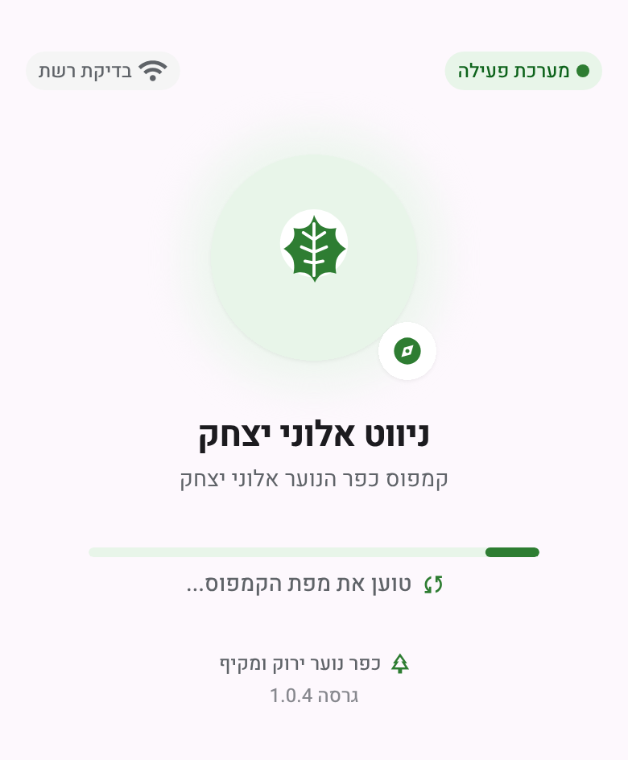
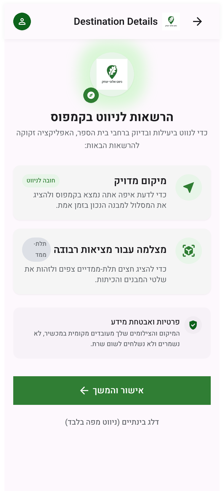
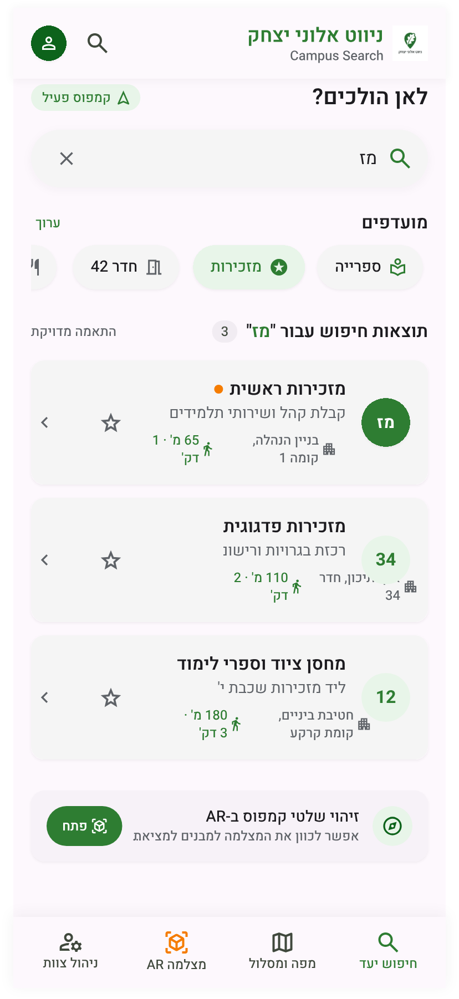
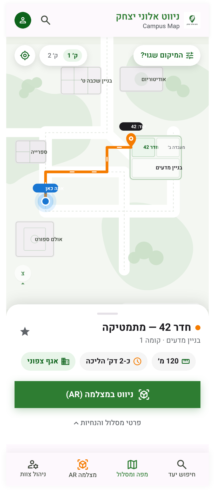
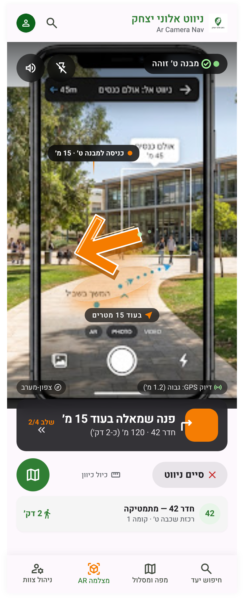
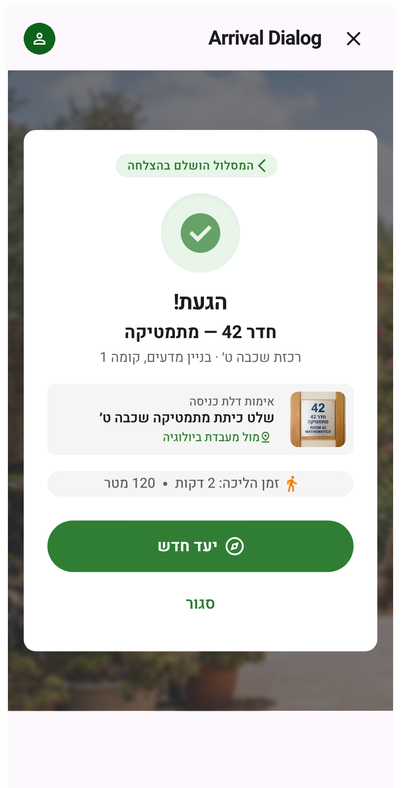
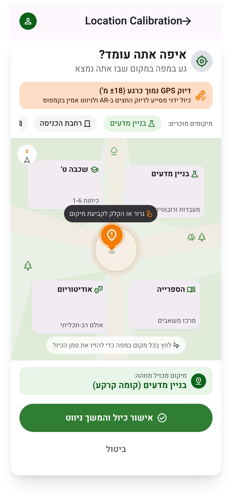
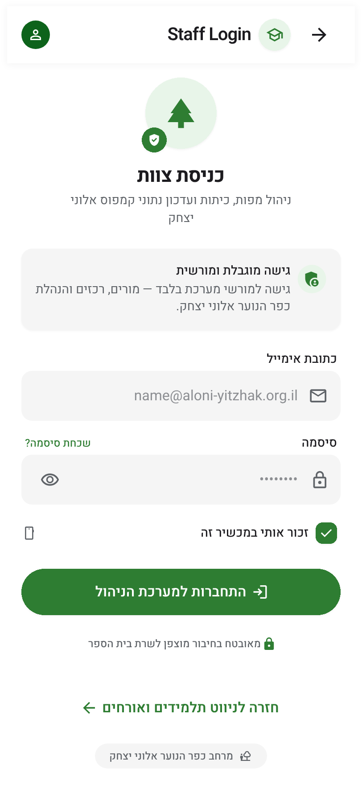
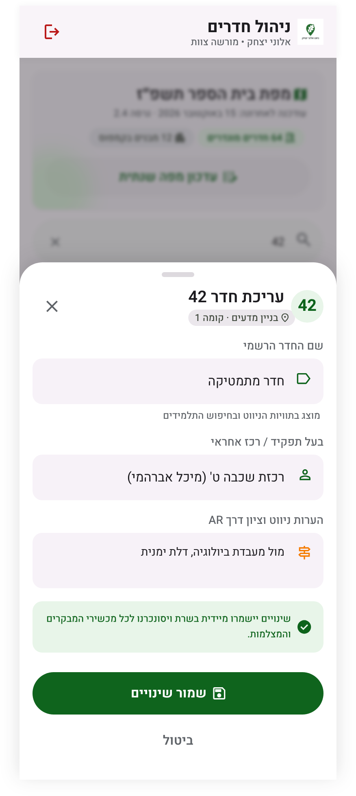
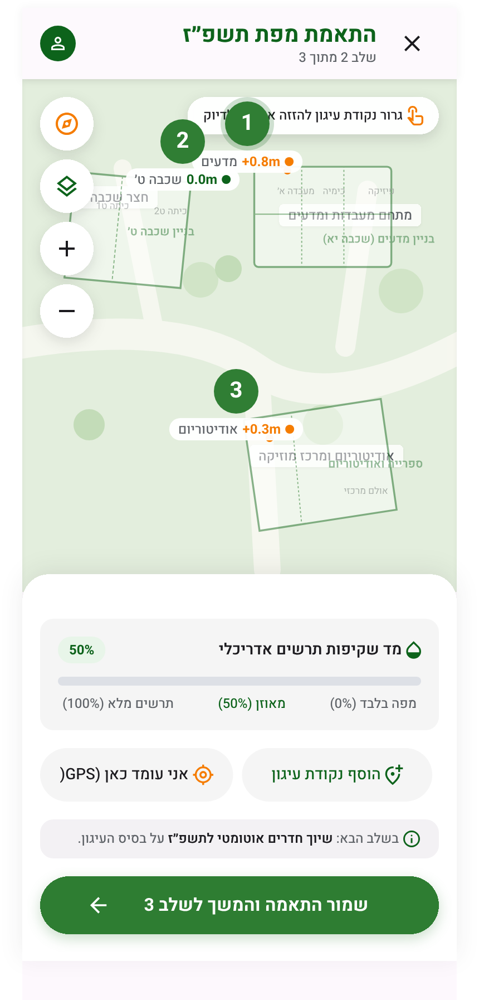

<div dir="rtl">

# עיצובי המסכים

עשרה Frames ב-Figma: תשעת המסכים, ומסך הצוות בשני מצבים (כניסה ועריכה). הקבצים נמצאים במאגר: PNG בקנה מידה 2x בתיקייה `docs/design/`, וקובצי SVG מקוריים ב-`docs/design/svg/`. מקובצי ה-SVG האלה נבנים קובצי ה-XML במטלה T30.

| מסך | קובץ | מחלקה | קובץ XML במטלה T30 |
| --- | --- | --- | --- |
| מסך פתיחה | `splash.png` | SplashActivity | `activity_splash.xml` |
| בקשת הרשאות | `permissions.png` | SplashActivity (מצב שני) | `view_permissions.xml` |
| חיפוש יעד | `search.png` | SearchActivity | `activity_search.xml`, `item_room.xml` |
| מפה ומסלול | `map.png` | MapActivity | `activity_map.xml` |
| מצלמה AR | `ar-nav.png` | ArNavActivity | `activity_ar_nav.xml` |
| הגעת ליעד | `arrival-dialog.png` | ArrivalDialog | `dialog_arrival.xml` |
| כיול ידני | `calibration-dialog.png` | CalibrationDialog | `dialog_calibration.xml` |
| כניסת צוות | `admin-login.png` | AdminActivity (מצב כניסה) | `activity_admin.xml` |
| ניהול חדרים | `admin.png` | AdminActivity (מצב עריכה) | `sheet_room_edit.xml` |
| התאמת מפה שנתית | `map-alignment.png` | MapAlignmentActivity | `activity_map_alignment.xml` |

## סקירת העיצוב

כל מסך נבדק מול רשימת הבדיקה ([מדריך העיצוב](https://github.com/Aloney-Yitzchak/aloney-navigation/wiki/מדריך-עיצוב-מסכים), סעיף 6) ומול מסמך הדרישות. שפת העיצוב נשמרה: ירוק ראשי, כתום למסלול ולחץ, כרטיסים מעוגלים ויישור לימין. אלה הממצאים, ומה הוחלט לגבי כל אחד:

| # | מסך | ממצא | החלטה |
| --- | --- | --- | --- |
| 1 | ארבעת המסכים הראשיים | נוסף סרגל ניווט תחתון עם ארבע לשוניות: חיפוש יעד, מפה ומסלול, מצלמה AR, ניהול צוות. הוא לא הופיע באפיון | **מאמצים.** `BottomNavigationView` משותף לארבעת המסכים, ותרשים המסכים מתעדכן |
| 2 | חיפוש יעד | הכניסה לצוות היא לשונית גלויה, ולא כפתור נסתר כמו באפיון | **מאמצים.** מסך הצוות מוגן בהתחברות, ואין סיבה להסתיר אותו |
| 3 | מפה ומסלול | כפתור "מיקום שגוי?" פותח את הכיול, במקום נגיעה ארוכה במפה | **מאמצים.** כפתור גלוי עדיף על מחווה שאף אחד לא יגלה |
| 4 | בקשת הרשאות | עוצב כמסך נפרד | מצב שני של SplashActivity, בלי מחלקה חדשה |
| 5 | כמה מסכים | כותרות באנגלית שנשארו מ-Figma: Destination Details, Arrival Dialog, Location Calibration, Staff Login, Campus Search, Campus Map | ב-XML כל הכותרות בעברית, מתוך `strings.xml` |
| 6 | מצלמה AR | המסך מצויר כטלפון בתוך טלפון, עם כפתור צילום ומצבי PHOTO/VIDEO של אפליקציית מצלמה | ב-XML תצוגת המצלמה ממלאת את המסך, בלי כפתור צילום |
| 7 | מצלמה AR | פס היעד העליון ("ניווט אל: אולם כנסים") הוא חלק מתמונת הרקע, ולא תואם ליעד שבכרטיס (חדר 42) | ב-XML פס יעד אמיתי ב-TextView, עם שם היעד שנבחר |
| 8 | כל הלשוניות | לשונית המצלמה צבועה כתום גם כשהיא לא נבחרה | צבע לפי מצב: ירוק לנבחרת, אפור לשאר. הכתום שמור למסלול, לחץ וליעד |
| 9 | כניסת צוות | "זכור אותי" ו"שכחת סיסמה?" לא מופיעים בדרישות | יורדים. Firebase שומר את ההתחברות ממילא |
| 10 | הגעת ליעד | תמונת שלט הדלת לאימות לא מופיעה בדרישות | יורדת בשלב זה, ונרשמת כרעיון לשיפור |
| 11 | כמה מסכים | טקסט משני אפור בהיר וקטן (מספר גרסה, הסברים) קשה לקריאה בשמש | ב-XML לפחות 14sp ובצבע #5F6368 |
| 12 | ניהול חדרים | שדה "הערות ניווט וציון דרך AR" לא קיים במודל הנתונים (לחדר יש מספר, שם, אחראי וכניסה) | יורד בשלב זה, ונרשם כרעיון לשיפור. נמצא במטלה T30 |

> [!NOTE]
> **הערה לתלמידים:** סקירת עיצוב היא חלק רגיל מהעבודה. כל ממצא מקבל החלטה, ומה שהשתנה מתעדכן במסמכים: כאן ממצאים 1–3 שינו את טבלת המסכים בתיק ואת תרשים המסכים. בפרק הרפלקציה בתיק כדאי לכתוב מה השתנה בין העיצוב לאפליקציה, ולמה.

## מהעיצוב ל-XML (T30)

כל Frame נבנה כקובץ XML לפי הטבלה למעלה, ושפת העיצוב יושבת במקום אחד:

- **צבעים, מידות וסגנונות:** `values/colors.xml`, `values/dimens.xml`, `values/styles.xml`, `values/themes.xml`. אף layout לא כותב צבע או גודל ישירות.
- **גופן:** Heebo בשלושה משקלים ב-`res/font/` (רישיון OFL: `HEEBO-OFL.txt`). בלי ריווח אותיות, כי הריווח של Material נועד לאותיות לטיניות.
- **אייקונים:** Material Symbols, הומרו ל-Vector Drawables על ידי `tools/material_icons.py`. חצי "קדימה" ו"אחורה" מתהפכים אוטומטית בימין-לשמאל; חצי "פנה ימינה/שמאלה" לא מתהפכים, כי הם כיוון אמיתי.
- **ימין לשמאל:** רק `start`/`end`, אף פעם `left`/`right`.
- **סרגל ניווט תחתון:** `menu/bottom_nav.xml` ו-`layout/view_bottom_nav.xml`, משותף לחיפוש, מפה ומצלמה.
- **מפה ומצלמה:** בשלב זה שטח ריק בצבע רקע. המפה נכנסת במטלה T29 והמצלמה במטלה T16.

### תמונות בדיקה (snapshots)

`LayoutSnapshotTest` מצייר כל מסך במחשב, בלי טלפון ובלי אמולטור (Paparazzi), בעברית ומימין לשמאל, עם אותם נתונים לדוגמה שיש בעיצוב. התמונות נשמרות ב-`app/src/test/snapshots/images/`, וכך אפשר להשוות כל מסך ל-PNG שלו כאן.

```bash
./gradlew recordPaparazziDebug   # מצייר מחדש את התמונות
./gradlew verifyPaparazziDebug   # נכשל אם מסך השתנה בלי שהתמונה עודכנה
```

GitHub Actions מריץ `verifyPaparazziDebug` בכל PR. אחרי שינוי מכוון ב-layout מריצים `record`, בודקים את התמונות החדשות ומעלים אותן יחד עם השינוי.

> [!NOTE]
> טקסט עברי שהוקלד לתוך שדה עם אייקון בתחילתו (שדה החיפוש, שדות העריכה) לא מופיע בתמונות האלה. זו מגבלה של הציור במחשב: באמולטור הטקסט מופיע, וצילום המסך `02-search` של בדיקות האמולטור מראה אותו.

## גלריה

| מסך פתיחה | בקשת הרשאות | חיפוש יעד | מפה ומסלול | מצלמה AR |
| --- | --- | --- | --- | --- |
|  |  |  |  |  |

| הגעת ליעד | כיול ידני | כניסת צוות | ניהול חדרים | התאמת מפה שנתית |
| --- | --- | --- | --- | --- |
|  |  |  |  |  |

</div>
