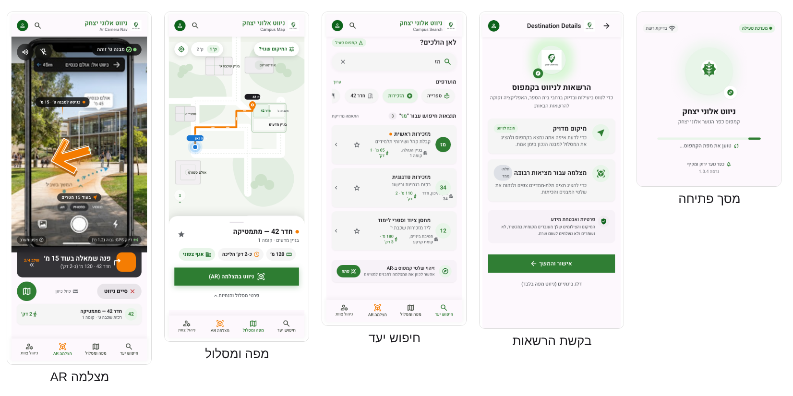
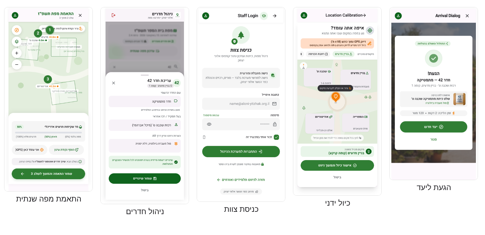

<div dir="rtl">

# מדריך עיצוב מסכים — ניווט אלוני יצחק

המדריך מסביר איך ליצור עיצוב אמיתי לכל מסך באפליקציה עם Google Stitch או Figma, לפני כתיבת ה-XML. הוא אינו חלק מתיק הפרויקט; בתיק מופיעות רק תמונות המסכים הסופיות.

## 1. איזה כלי לבחור

מתחילים ב-Google Stitch כדי לקבל טיוטה מהירה מתיאור במילים, ומעבירים ל-Figma כדי לסדר, לאחד ולהכין לפיתוח. שני הכלים חינמיים עם חשבון Google.

|  | Google Stitch | Figma |
| --- | --- | --- |
| כתובת | [stitch.withgoogle.com](https://stitch.withgoogle.com/) | [figma.com](https://www.figma.com/) |
| איך עובדים | כותבים פרומפט, מקבלים מסך מעוצב | מציירים בעצמם, או מדביקים מ-Stitch ומתקנים |
| חוזק | טיוטה ראשונה תוך דקה | שליטה מלאה, רכיבים חוזרים, קישור בין מסכים לאב-טיפוס |
| חולשה | כל מסך נוצר בנפרד, ולכן הסגנון לא תמיד אחיד | איטי יותר להתחיל מאפס |
| ייצוא | Copy to Figma, או קוד HTML/CSS | תמונות PNG למסמך, ומידות וצבעים למפתח |

בזמן כתיבת המדריך, Stitch זמין דרך Google Labs עם מכסת יצירות חודשית ומצב מובייל, ו-Copy to Figma פועל במצב Standard בלבד ([מקור](https://codecademy.com/article/google-stitch-tutorial-ai-powered-ui-design-tool)). הכלים משתנים מהר, ולכן כדאי לבדוק את האפשרויות העדכניות.

### 1.1 התהליך מעיצוב לתיק

1. מעתיקים את פרומפט הבסיס (סעיף 3) ואת הפרומפט של המסך (סעיף 4) ל-Stitch, במצב Mobile.
2. מתקנים בפרומפטים קצרים נוספים עד שהמסך נכון.
3. Copy to Figma, ובונים ב-Figma קובץ אחד עם כל 9 המסכים.
4. מאחדים צבעים וגופנים לפי שפת העיצוב (סעיף 2), ומקשרים בין המסכים לאב-טיפוס לחיץ.
5. בונים את המסך ב-Android לפי העיצוב.
6. לתיק הפרויקט נכנס **צילום מסך מהאפליקציה האמיתית**, לא העיצוב מ-Figma — ההנחיות דורשות "תמונת מסך" של המסך שבנוי.

## 2. שפת העיצוב

שפת העיצוב נקבעת פעם אחת ומודבקת לכל פרומפט, כדי שכל המסכים ייראו כחלק מאותה אפליקציה. הערכים כאן הם בחירה של הפרויקט, ואפשר לשנות אותם.

| מרכיב | ערך | שימוש |
| --- | --- | --- |
| צבע ראשי | ירוק יער #2E7D32 | סרגל עליון, כפתורים ראשיים |
| צבע הדגשה | כתום #F57C00 | חץ הניווט, קו המסלול, יעד |
| רקע | לבן #FFFFFF, ואפור בהיר #F5F5F5 לכרטיסים |  |
| טקסט | כמעט שחור #1C1B1F, ואפור #5F6368 למשני |  |
| שגיאה | אדום #C62828 | הודעות שגיאה בלבד |
| גופן | Heebo (Google Fonts, תומך בעברית) | כותרות 22sp, טקסט 16sp, משני 14sp |
| כיוון | RTL מלא, יישור לימין | כל המסכים |
| ריווח | רשת של 8dp | שוליים 16dp, מרווח בין רכיבים 8 או 16dp |
| אזור נגיעה | לפחות 48dp | כל כפתור ופריט ברשימה |
| פינות | 12dp לכרטיסים, 28dp לכפתורים |  |

**רכיבים חוזרים:** סרגל עליון עם כותרת, שדה חיפוש מעוגל, כרטיס חדר (מספר, שם, בעל תפקיד), כפתור צף (FAB), וגיליון תחתון עם מרחק ונקודה הבאה.

בקובץ Android הערכים האלה נכנסים ל-`colors.xml`, `dimens.xml` ו-`themes.xml`, כך שהעיצוב והקוד משתמשים באותם שמות.

## 3. פרומפט הבסיס

הפרומפטים כתובים באנגלית כי הכלים מבינים אותה טוב יותר, אבל כל הטקסט שמופיע על המסך מבוקש בעברית. מדביקים את פרומפט הבסיס, ומיד אחריו את פרומפט המסך מסעיף 4.


<div dir="ltr">

```text
Design a native Android phone screen (Material 3, 412x915 dp) for
"ניווט אלוני יצחק", a campus navigation app for a high school in Israel.

Language and direction:
- All visible text in Hebrew, right-to-left layout, right-aligned text.
- Icons that indicate direction (back arrow, chevrons) are mirrored for RTL.

Visual style:
- Primary color forest green #2E7D32 (top app bar, primary buttons).
- Accent orange #F57C00, used ONLY for the route line, navigation arrow
  and destination marker.
- Background white #FFFFFF, cards light gray #F5F5F5.
- Text #1C1B1F, secondary text #5F6368. Error red #C62828.
- Font: Heebo. Title 22sp, body 16sp, secondary 14sp.
- 8dp spacing grid, 16dp screen margins, 12dp card corners,
  28dp button corners, minimum touch target 48dp.
- Clean, friendly, high contrast, readable outdoors in sunlight.

Show realistic content (room numbers like "42", "יא3", names like
"ספרייה", "מזכירות"). Do not add features that are not described.
```

</div>


## 4. פרומפט לכל מסך

תשעה מסכים, לפי תרשים זרימת המסכים בתיק הפרויקט. כל פרומפט מתאר מה רואים ומה אפשר לעשות, ולא איך לממש.

### 4.1 מסך פתיחה — SplashActivity


<div dir="ltr">

```text
Screen: Splash / loading.
- Centered app logo: a simple map pin combined with an oak leaf, in green.
- App name "ניווט אלוני יצחק" below the logo, title size.
- Linear progress bar with the caption "טוען את מפת הקמפוס...".
- Error state variant: caption "אין חיבור לאינטרנט" and an outlined
  button "נסה שוב".
```

</div>


### 4.2 בקשת הרשאות


<div dir="ltr">

```text
Screen: Permissions explanation, shown before the Android system dialog.
- Two cards, one per permission, each with an icon, a bold title and one line:
  1. Location icon, "מיקום" — "כדי לדעת איפה אתה בקמפוס".
  2. Camera icon, "מצלמה" — "כדי להציג חצים ולזהות מבנים".
- Small note: "המיקום שלך לא נשמר ולא נשלח לשום מקום".
- Primary filled button at the bottom: "אישור והמשך".
```

</div>


### 4.3 חיפוש יעד — SearchActivity


<div dir="ltr">

```text
Screen: Search destination (main screen).
- Top app bar with title "לאן הולכים?".
- Large rounded search field with a search icon and placeholder
  "מספר חדר, שם או בעל תפקיד".
- Section "מועדפים": horizontal row of 3 chips ("ספרייה", "מזכירות", "42").
- Section "חיפושים אחרונים": vertical list of room cards. Each card shows the
  room number in a green circle, room name, owner in secondary text
  (e.g. "רכזת שכבה ט'"), and a star icon on the left side.
- Show the list state while typing "מז": 3 matching results.
```

</div>


### 4.4 מפה ומסלול — MapActivity


<div dir="ltr">

```text
Screen: 2D map with route.
- Full-screen OpenStreetMap-style map (light, minimal), with the school's
  floor plan drawing overlaid semi-transparently on top of the buildings.
- Orange route line from a blue "you are here" dot to an orange destination pin.
- Bottom sheet: destination "חדר 42 — מתמטיקה", distance "120 מ'",
  time "כ-2 דק' הליכה", and a primary button "מצלמה" with a camera icon.
- Small floating button on the map: "המיקום שגוי?" (opens calibration).
- Attribution text at the bottom corner: "© OpenStreetMap contributors".
```

</div>


### 4.5 מצלמה AR — ArNavActivity


<div dir="ltr">

```text
Screen: Augmented reality navigation over the live camera.
- Full-screen camera image of an outdoor school path with trees and
  low buildings.
- A large 3D orange arrow floating above the path, pointing forward-left.
- Top pill label: "מבנה ט' זוהה" with a small check icon (building recognition).
- Bottom translucent dark bar with white text: "פנה שמאלה בעוד 15 מ'"
  and below it "חדר 42 · 120 מ'".
- Round map button in the bottom corner to switch back to the map.
```

</div>


### 4.6 כיול ידני — CalibrationDialog


<div dir="ltr">

```text
Screen: Full-screen dialog over the map.
- Title "איפה אתה עומד?" and one line "גע במפה במקום שבו אתה נמצא".
- Map area with a draggable pin.
- Two buttons at the bottom: filled "אישור" and text button "ביטול".
```

</div>


### 4.7 הגעת ליעד — ArrivalDialog


<div dir="ltr">

```text
Screen: Arrival dialog over the camera view.
- Large green check icon.
- Title "הגעת!", room name "חדר 42 — מתמטיקה", owner line in secondary text.
- Primary button "יעד חדש" and a text button "סגור".
```

</div>


### 4.8 עריכה לצוות — AdminActivity


<div dir="ltr">

```text
Screen: Staff area, two states.
State A, login: title "כניסת צוות", email and password fields,
  primary button "כניסה".
State B, logged in:
- Top app bar "ניהול חדרים" with a logout icon.
- Search field and a list of rooms (number, name, owner) with an edit icon.
- Edit bottom sheet for room "42": fields "שם החדר" and "בעל תפקיד",
  button "שמור".
- Card at the top: "מפת בית הספר תשפ"ז" with a button "עדכון מפה שנתית".
```

</div>


### 4.9 התאמת מפה שנתית — MapAlignmentActivity


<div dir="ltr">

```text
Screen: Yearly floor-plan alignment tool for staff (works best on a tablet).
- Top app bar "התאמת מפת תשפ"ז" with steps indicator "שלב 2 מתוך 3".
- Map with the school floor-plan image overlaid at 50% opacity.
- Three numbered control-point markers (1, 2, 3), each connecting a point
  on the drawing to a point on the map, with a thin line between them.
- Bottom panel: opacity slider, buttons "הוסף נקודת עיגון",
  "אני עומד כאן" (uses GPS), and primary "שמור התאמה".
- Step 3 variant: tapping a room on the drawing opens a sheet with fields
  "מספר חדר", "שם", "בעל תפקיד" and a button "שייך חדר".
```

</div>


## 5. מ-Stitch ל-Figma ול-Android

### 5.1 תיקונים ב-Stitch

אחרי היצירה הראשונה מתקנים בפרומפט קצר ומדויק, דבר אחד בכל פעם. דוגמאות:

- `Move the star icon to the left edge of each card and keep text right-aligned.`
- `Use the accent orange only for the route line, not for buttons.`
- `The bottom sheet text is English; rewrite it in Hebrew exactly as specified.`

### 5.2 ב-Figma

1. יוצרים קובץ בשם "ניווט אלוני יצחק — מסכים" ו-Frame בגודל Android Compact (412×917).
2. ב-Stitch בוחרים את המסך, Copy to Figma, ומדביקים לתוך ה-Frame.
3. מגדירים את הצבעים מסעיף 2 כ-Color Styles ואת הגופנים כ-Text Styles, ומחליפים כל צבע מקומי בסגנון.
4. הופכים רכיבים חוזרים (כרטיס חדר, סרגל עליון, גיליון תחתון) ל-Components, כדי ששינוי אחד יתעדכן בכל המסכים.
5. במצב Prototype מחברים בין המסכים לפי תרשים זרימת המסכים. אב-טיפוס כזה הוא דרך טובה לבדוק את הזרימה עם חברים לפני שכותבים קוד.
6. מייצאים כל מסך ל-PNG בקנה מידה 2x לתיקיית `docs/design/` במאגר.

### 5.3 מ-Figma ל-XML

- בוחרים רכיב ב-Figma ומעתיקים את המידות והצבעים ממצב Dev Mode או מלוח Inspect.
- כל צבע נכנס פעם אחת ל-`colors.xml` בשם זהה ל-Color Style, וכל מידה חוזרת ל-`dimens.xml`.
- את מסך המפה ומסך המצלמה לא מעצבים ב-XML עד הסוף: המפה והחץ מצוירים בקוד, וה-XML מכיל רק את המסגרת והכפתורים.
- מעצבים לפי המסך הקטן ביותר שבודקים עליו, ובודקים על לפחות שני גדלים.

### 5.4 איך זה נכנס לתיק

בפרק "מבנה / ארכיטקטורה" בתיק, לכל מסך מצרפים צילום מסך מהאפליקציה האמיתית. עיצובי Figma יכולים להופיע בנספחים, ובפרק הרפלקציה אפשר לכתוב מה השתנה בין העיצוב למסך שנבנה בפועל.

## 6. רשימת בדיקה לפני שמכניסים מסך לתיק

- [ ] כל הטקסט בעברית, מיושר לימין, וחצים וחיצי "חזרה" הפוכים.
- [ ] רק צבעים מסעיף 2; הכתום מופיע רק על מסלול, חץ ויעד.
- [ ] כל כפתור ופריט ברשימה בגובה 48dp לפחות.
- [ ] הטקסט קריא בשמש: ניגודיות גבוהה, בלי טקסט אפור בהיר על לבן.
- [ ] כל הנחיה שמופיעה כחץ מופיעה גם כטקסט.
- [ ] אין במסך רכיב שלא מופיע בדרישות (מסמך ה-SRS), ואין דרישה בלי רכיב.
- [ ] הצילום בתיק לקוח מהאפליקציה האמיתית, וכל רכיב בו מוסבר בטבלת המסכים.

## 7. העיצובים שהתקבלו

עשרה Frames ב-Figma: תשעת המסכים, ומסך הצוות בשני מצבים (כניסה ועריכה). הקבצים נמצאים במאגר: PNG בקנה מידה 2x בתיקייה `docs/design/`, וקובצי SVG מקוריים ב-`docs/design/svg/`. מקובצי ה-SVG האלה נבנים קובצי ה-XML במטלה T30.

| מסך | קובץ | מחלקה | קובץ XML במטלה T30 |
| --- | --- | --- | --- |
| מסך פתיחה | `splash.png` | SplashActivity | `activity_splash.xml` |
| בקשת הרשאות | `permissions.png` | SplashActivity (מצב שני) | `view_permissions.xml` |
| חיפוש יעד | `search.png` | SearchActivity | `activity_search.xml`, `item_room.xml` |
| מפה ומסלול | `map.png` | MapActivity | `activity_map.xml` |
| מצלמה AR | `ar-nav.png` | ArNavActivity | `activity_ar_nav.xml` |
| הגעת ליעד | `arrival-dialog.png` | ArrivalDialog | `dialog_arrival.xml` |
| כיול ידני | `calibration-dialog.png` | CalibrationDialog | `dialog_calibration.xml` |
| כניסת צוות | `admin-login.png` | AdminActivity (מצב כניסה) | `activity_admin.xml` |
| ניהול חדרים | `admin.png` | AdminActivity (מצב עריכה) | `sheet_room_edit.xml` |
| התאמת מפה שנתית | `map-alignment.png` | MapAlignmentActivity | `activity_map_alignment.xml` |



<sub>עיצובי המסכים, חלק 1: פתיחה, הרשאות, חיפוש, מפה ומצלמה</sub>



<sub>עיצובי המסכים, חלק 2: הגעה ליעד, כיול, כניסת צוות, ניהול חדרים והתאמת מפה</sub>

### 7.1 סקירת העיצוב

כל מסך נבדק מול רשימת הבדיקה (סעיף 6) ומול מסמך הדרישות. שפת העיצוב נשמרה: ירוק ראשי, כתום למסלול ולחץ, כרטיסים מעוגלים ויישור לימין. אלה הממצאים, ומה הוחלט לגבי כל אחד:

| # | מסך | ממצא | החלטה |
| --- | --- | --- | --- |
| 1 | ארבעת המסכים הראשיים | נוסף סרגל ניווט תחתון עם ארבע לשוניות: חיפוש יעד, מפה ומסלול, מצלמה AR, ניהול צוות. הוא לא הופיע באפיון | **מאמצים.** `BottomNavigationView` משותף לארבעת המסכים, ותרשים המסכים מתעדכן |
| 2 | חיפוש יעד | הכניסה לצוות היא לשונית גלויה, ולא כפתור נסתר כמו באפיון | **מאמצים.** מסך הצוות מוגן בהתחברות, ואין סיבה להסתיר אותו |
| 3 | מפה ומסלול | כפתור "מיקום שגוי?" פותח את הכיול, במקום נגיעה ארוכה במפה | **מאמצים.** כפתור גלוי עדיף על מחווה שאף אחד לא יגלה |
| 4 | בקשת הרשאות | עוצב כמסך נפרד | מצב שני של SplashActivity, בלי מחלקה חדשה |
| 5 | כמה מסכים | כותרות באנגלית שנשארו מ-Figma: Destination Details, Arrival Dialog, Location Calibration, Staff Login, Campus Search, Campus Map | ב-XML כל הכותרות בעברית, מתוך `strings.xml` |
| 6 | מצלמה AR | המסך מצויר כטלפון בתוך טלפון, עם כפתור צילום ומצבי PHOTO/VIDEO של אפליקציית מצלמה | ב-XML תצוגת המצלמה ממלאת את המסך, בלי כפתור צילום |
| 7 | מצלמה AR | פס היעד העליון ("ניווט אל: אולם כנסים") הוא חלק מתמונת הרקע, ולא תואם ליעד שבכרטיס (חדר 42) | ב-XML פס יעד אמיתי ב-TextView, עם שם היעד שנבחר |
| 8 | כל הלשוניות | לשונית המצלמה צבועה כתום גם כשהיא לא נבחרה | צבע לפי מצב: ירוק לנבחרת, אפור לשאר. הכתום שמור למסלול, לחץ וליעד |
| 9 | כניסת צוות | "זכור אותי" ו"שכחת סיסמה?" לא מופיעים בדרישות | יורדים. Firebase שומר את ההתחברות ממילא |
| 10 | הגעת ליעד | תמונת שלט הדלת לאימות לא מופיעה בדרישות | יורדת בשלב זה, ונרשמת כרעיון לשיפור |
| 11 | כמה מסכים | טקסט משני אפור בהיר וקטן (מספר גרסה, הסברים) קשה לקריאה בשמש | ב-XML לפחות 14sp ובצבע #5F6368 |
| 12 | ניהול חדרים | שדה "הערות ניווט וציון דרך AR" לא קיים במודל הנתונים (לחדר יש מספר, שם, אחראי וכניסה). נמצא בזמן בניית ה-XML (T30) | יורד בשלב זה, ונרשם כרעיון לשיפור |

ממצאים 5–12 תוקנו בקובצי ה-XML במטלה T30. איך העיצוב הפך ל-XML, ואיך כל מסך נבדק מול העיצוב שלו בתמונת snapshot, מתואר ב-`docs/design/README.md` במאגר.

> [!NOTE]
> **הערה לתלמידים:** סקירת עיצוב היא חלק רגיל מהעבודה. כל ממצא מקבל החלטה, ומה שהשתנה מתעדכן במסמכים: כאן ממצאים 1–3 שינו את טבלת המסכים בתיק ואת תרשים המסכים. בפרק הרפלקציה בתיק כדאי לכתוב מה השתנה בין העיצוב לאפליקציה, ולמה.

</div>
