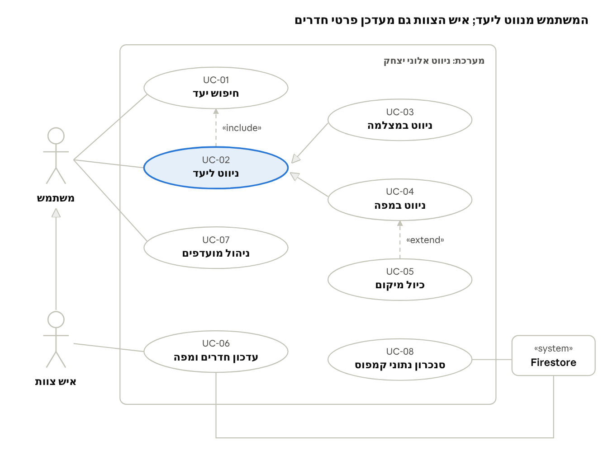

# מסמך דרישות (SRS) — ניווט אלוני יצחק

מסמך זה מגדיר מה המערכת צריכה לעשות, לפני שמחליטים איך לבנות אותה. הוא אינו חלק מתיק הפרויקט שמשרד החינוך דורש, ומובא כדוגמה לעבודה הנדסית לפי תקן ISO/IEC/IEEE 29148.

## 1. מבוא

### 1.1 מטרת המסמך

המסמך מגדיר את כל הדרישות מאפליקציית "ניווט אלוני יצחק", כך שכל דרישה ניתנת לבדיקה. הוא משמש בסיס למסמך התיכון (SDD), לפירוק המטלות ולבדיקות הקבלה בסוף הפרויקט.

### 1.2 תחולה

**בתוך התחולה:** ניווט הולכי רגל בין מבני הקמפוס לכניסה של כל חדר, בתצוגת מצלמה ובתצוגת מפה; זיהוי מבנים במודל למידת מכונה; עדכון נתוני חדרים על ידי צוות.

**מחוץ לתחולה:** ניווט בתוך מבנה סגור ובין קומות; ניווט ברכב; שילוב עם מערכת השעות; התראות על שינויי חדרים.

### 1.3 מונחים

| מונח | פירוש |
| --- | --- |
| AR | מציאות רבודה: הוספת מידע וירטואלי על גבי תמונת המצלמה |
| ARCore | ספריית Google למעקב אחר תנועת הטלפון במרחב ולעיגון אובייקטים |
| GPS | מערכת מיקום לוויינית; בטלפון נותנת מיקום בשגיאה של כמה מטרים |
| Firestore | בסיס נתונים בענן של Firebase, מבוסס אוספים ומסמכים |
| Room | ספריית Android לבסיס נתונים מקומי מעל SQLite |
| TFLite | TensorFlow Lite: הרצת מודל למידת מכונה על הטלפון |
| נקודה (Node) | מקום פיזי בקמפוס: צומת שבילים או כניסה לחדר |
| קשת (Edge) | קטע שביל בין שתי נקודות |
| MoSCoW | שיטת עדיפות: Must (חובה), Should (רצוי), Could (אפשרי), Won't (לא בגרסה זו) |

### 1.4 מסמכים קשורים

- תיק הפרויקט — המסמך הרשמי להגשה, לפי הנחיות משרד החינוך
- מסמך התיכון (SDD) — ארכיטקטורה ותרשימי UML
- תוכנית ניהול הפרויקט — לו"ז, מטלות וסיכונים
- הנחיות לכתיבת תיק פרויקט בחלופת תכנות טלפונים חכמים, הנדסת תוכנה 883589

## 2. תיאור כללי

### 2.1 הקשר המוצר

האפליקציה עומדת בפני עצמה ופועלת על טלפון Android. היא מתחברת לשני שירותי ענן: Firestore, שבו נשמרים נתוני הקמפוס, ו-Firebase Authentication, להתחברות אנשי צוות. מודל זיהוי המבנים מאומן מחוץ לאפליקציה ונארז בתוכה כקובץ.

### 2.2 סוגי משתמשים

| סוג משתמש | מי | מה הוא עושה | הרשאה |
| --- | --- | --- | --- |
| משתמש | תלמיד, מורה או אורח | מחפש יעד, מנווט, שומר מועדפים | ללא התחברות |
| איש צוות | מזכירות או רכזים | כל מה שמשתמש עושה, ובנוסף מעדכן פרטי חדרים | התחברות עם חשבון צוות |
| מפתח | בונה האפליקציה | ממפה את הקמפוס, מאמן את המודל ומעלה נתונים | גישה למסוף Firebase |

### 2.3 סביבת הפעלה

- טלפון Android 8.0 (API 26) ומעלה, עם GPS, מצפן ומצלמה אחורית.
- ARCore: רצוי. במכשיר שאינו נתמך האפליקציה עובדת במצב גיבוי.
- חיבור לאינטרנט נדרש רק לטעינה הראשונה ולעדכון חדרים.

### 2.4 אילוצים

- שפת הפיתוח היא Java עם ממשקי XML, כמו בתוכנית הלימודים.
- אין תקציב לחומרה: אין משדרים בקמפוס, הכול נשען על הטלפון.
- השימוש ב-Firebase נשאר בתוך המכסות החינמיות.
- המיקום של המשתמש לא נשמר ולא נשלח לשום מקום.

### 2.5 הנחות ותלויות

- השבילים בין המבנים פתוחים לשמיים, ולכן GPS קולט בהם.
- המשתמש מחזיק את הטלפון בגובה החזה כשהוא במסך המצלמה.
- מבני הקמפוס לא ישתנו מהותית במהלך השנה; אם ישתנו, יש לאמן את המודל מחדש.

## 3. דרישות פונקציונליות

למערכת 13 דרישות פונקציונליות: 9 חובה (Must) ו-4 רצויות (Should).

| מזהה | דרישה | עדיפות |
| --- | --- | --- |
| FR-01 | המשתמש מחפש יעד לפי מספר חדר, שם חדר או בעל תפקיד, ומקבל רשימת התאמות תוך כדי הקלדה | Must |
| FR-02 | המשתמש שומר יעדים כמועדפים ורואה את 10 החיפושים האחרונים | Should |
| FR-03 | המערכת מחשבת את מסלול ההליכה הקצר ביותר מהמיקום הנוכחי לכניסה ליעד, לאורך שבילי הקמפוס | Must |
| FR-04 | מסך המצלמה מציג חץ בכיוון ההליכה, מרחק ליעד ושם הנקודה הבאה | Must |
| FR-05 | מסך המפה מציג מפת OpenStreetMap ומעליה את תוכנית בית הספר של השנה הנוכחית, את המסלול ואת מיקום המשתמש | Must |
| FR-06 | המערכת מודיעה "הגעת" כשהמשתמש במרחק של עד 5 מטר מהכניסה ליעד | Must |
| FR-07 | המערכת מזהה מהמצלמה מול איזה מבנה המשתמש עומד, ומתקנת את המיקום לפי הזיהוי | Must |
| FR-08 | המשתמש מסמן על המפה את מיקומו כשהמיקום המוצג שגוי | Should |
| FR-09 | המערכת מסנכרנת את נתוני הקמפוס מ-Firestore, שומרת אותם מקומית, ומנווטת גם בלי אינטרנט | Must |
| FR-10 | איש צוות מתחבר ומעדכן שם ובעל תפקיד של חדר | Should |
| FR-11 | במכשיר ללא ARCore מסך המצלמה מציג את החץ לפי המצפן בלבד | Must |
| FR-12 | המערכת מבקשת הרשאות מיקום ומצלמה ומסבירה למה הן נדרשות | Must |
| FR-13 | איש צוות טוען את תרשים בית הספר של השנה, מתאים אותו למפה בעזרת נקודות עיגון, ומשייך לכל חדר את מיקום הכניסה שלו | Should |

### 3.1 דוגמה לפירוט דרישה: FR-03 חישוב מסלול

| שדה | תוכן |
| --- | --- |
| קלט | מיקום המשתמש (קו רוחב ואורך) ומספר חדר היעד |
| עיבוד | מציאת הנקודה בשביל הקרובה למשתמש; חישוב המסלול הקצר בגרף השבילים עד נקודת הכניסה של היעד |
| פלט | רשימה מסודרת של נקודות ואורך המסלול במטרים |
| מקרי קצה | היעד לא קיים — הודעת שגיאה; המשתמש מחוץ לקמפוס — הודעה "התקרב לבית הספר"; אין מסלול בגרף — הודעה ודיווח למפתח |
| תנאי קבלה | המסלול שמתקבל זהה למסלול הקצר שחושב ידנית בשלושה מקרי מבחן |

במסמך מלא כל דרישה מפורטת כך. כאן מוצגת דרישה אחת כדוגמה.

## 4. מקרי שימוש

תרשים מקרי שימוש · 8 מקרים, 3 שחקנים

איש הצוות יורש את כל מקרי השימוש של המשתמש (חץ ההכללה ביניהם). ניווט ליעד כולל תמיד חיפוש יעד (include), וכיול מיקום הוא הרחבה אפשרית של ניווט במפה (extend). ניווט במצלמה וניווט במפה הם שני סוגים של ניווט ליעד.

### 4.1 UC-02 ניווט ליעד

| שדה | תוכן |
| --- | --- |
| שחקן | משתמש |
| תנאי מוקדם | נתוני הקמפוס סונכרנו; הרשאת מיקום ניתנה |
| תרחיש עיקרי | 1. המשתמש בוחר יעד (UC-01). 2. המערכת מחשבת מסלול ומציגה מסך מפה. 3. המשתמש עובר למסך מצלמה. 4. המערכת מעדכנת חץ ומרחק בזמן ההליכה. 5. המשתמש מגיע במרחק של עד 5 מטר מהכניסה. 6. המערכת מציגה "הגעת". |
| תרחיש חלופי | 4א. המשתמש סוטה מהמסלול ביותר מ-15 מטר — המערכת מחשבת מסלול חדש. 4ב. המצלמה מזהה מבנה — המיקום מתוקן לפי הזיהוי. |
| תנאי סיום | המשתמש ליד היעד; ההגעה נשמרת בחיפושים האחרונים |

### 4.2 UC-06 עדכון פרטי חדר

| שדה | תוכן |
| --- | --- |
| שחקנים | איש צוות; Firestore |
| תנאי מוקדם | איש הצוות מחובר עם חשבון צוות |
| תרחיש עיקרי | 1. איש הצוות בוחר חדר. 2. משנה שם או בעל תפקיד. 3. שומר. 4. המערכת כותבת ל-Firestore. 5. כל המכשירים מקבלים את העדכון בסנכרון הבא (UC-08). |
| תרחיש חלופי | 4א. אין אינטרנט — השמירה נכשלת עם הודעה ברורה, והנתון לא משתנה. |
| תנאי סיום | פרטי החדר המעודכנים זמינים לכל המשתמשים |

## 5. ממשקים חיצוניים

### 5.1 ממשק משתמש

- כל המסכים בעברית, מימין לשמאל, בגופן מערכת שגודלו משתנה לפי הגדרות הנגישות של הטלפון.
- כל הנחיה שמוצגת על המצלמה מופיעה גם כטקסט בתחתית המסך.
- מעבר בין מסך המפה למסך המצלמה בנגיעה אחת.
- סרגל ניווט תחתון מחבר את ארבעת המסכים הראשיים: חיפוש יעד, מפה ומסלול, מצלמה AR וניהול צוות.
- כפתור "מיקום שגוי?" במסך המפה פותח את הכיול הידני (FR-08).
- עיצוב כל המסכים, וסקירת העיצוב מול הדרישות, נמצאים ב[מדריך עיצוב המסכים](מדריך-עיצוב-מסכים), סעיף 7.

### 5.2 ממשקי חומרה

| רכיב | שימוש | ממשק Android |
| --- | --- | --- |
| GPS | מיקום המשתמש | Fused Location Provider |
| מצפן, ג'ירוסקופ ואקסלרומטר | כיוון הטלפון | TYPE\_ROTATION\_VECTOR |
| אקסלרומטר | זיהוי צעדים בין עדכוני מיקום | TYPE\_STEP\_DETECTOR |
| מצלמה אחורית | תמונה חיה וזיהוי מבנים | CameraX |

### 5.3 ממשקי תוכנה

| מערכת | כיוון | מה עובר |
| --- | --- | --- |
| Firestore | קריאה וכתיבה | חדרים, נקודות וקשתות |
| Firebase Authentication | קריאה | זהות איש הצוות |
| ARCore | קריאה | מיקום וכיוון המצלמה במרחב |
| TensorFlow Lite | קריאה | תווית המבנה ורמת הוודאות לכל תמונה |
| Room (SQLite) | קריאה וכתיבה | עותק מקומי של נתוני הקמפוס, מועדפים וחיפושים אחרונים |

## 6. דרישות לא-פונקציונליות

כל דרישה כאן כוללת מדד שאפשר למדוד, אחרת אי אפשר לבדוק אם עמדנו בה.

| מזהה | תחום | דרישה | מדד לבדיקה |
| --- | --- | --- | --- |
| NFR-01 | ביצועים | החץ מתעדכן בצורה חלקה | לפחות 10 עדכונים בשנייה |
| NFR-02 | ביצועים | חישוב מסלול מהיר | פחות משנייה אחת בכל זוג נקודות בקמפוס |
| NFR-03 | ביצועים | פתיחה מהירה | המסך הראשי מוצג תוך 3 שניות בפתיחה שנייה ואילך |
| NFR-04 | דיוק | המשתמש מגיע לכניסה הנכונה | ב-9 מתוך 10 ניסויי שטח המשתמש עוצר מול הדלת הנכונה |
| NFR-05 | דיוק | זיהוי מבנים אמין | דיוק של 85% לפחות על קבוצת הבדיקה של המודל |
| NFR-06 | זמינות | עבודה בלי אינטרנט | כל הדרישות פרט ל-FR-10 פועלות במצב טיסה אחרי סנכרון ראשון |
| NFR-07 | אמינות | ללא קריסות | אפס קריסות ב-30 דקות שימוש רצוף בבדיקות השטח |
| NFR-08 | סוללה | חיסכון | GPS, מצלמה ומודל פועלים רק כשמסך ניווט פתוח |
| NFR-09 | פרטיות | המיקום נשאר בטלפון | אין שליחה של מיקום לשרת; נבדק בסקירת קוד |
| NFR-10 | אבטחה | רק צוות מעדכן חדרים | כללי האבטחה ב-Firestore דוחים כתיבה ללא התחברות |
| NFR-11 | שימושיות | משתמש חדש מסתדר לבד | 4 מתוך 5 משתמשים חדשים מגיעים ליעד בלי הסבר |
| NFR-12 | תחזוקה | עדכון שנתי בלי קוד | שינוי שיבוץ חדר מתבצע ממסך הצוות בלבד |

## 7. דרישות נתונים

| נתון | היקף משוער | מקור | נשמר ב | פרטיות |
| --- | --- | --- | --- | --- |
| חדרים | כ-74 | תרשים מבנה ביה"ס תשפ"ז ועדכוני צוות | Firestore + עותק ב-Room | ציבורי בתוך בית הספר |
| נקודות וקשתות | מאות | מיפוי שטח של המפתח | Firestore + עותק ב-Room | ציבורי בתוך בית הספר |
| מועדפים וחיפושים אחרונים | עד עשרות לכל משתמש | המשתמש | Room בלבד | אישי, לא יוצא מהטלפון |
| מיקום וכיוון המשתמש | רציף בזמן ניווט | חיישני הטלפון | זיכרון בלבד | לא נשמר |
| תמונות לאימון המודל | מאות לכל מבנה | צילום שטח של המפתח | מחוץ לאפליקציה | ללא אנשים מזוהים בתמונות |
| מודל זיהוי המבנים | קובץ אחד | אימון | בתוך האפליקציה | — |

- **שלמות נתונים:** לכל חדר חייבת להיות נקודת כניסה קיימת, ולכל קשת שתי נקודות קיימות. הסנכרון דוחה נתונים שלא עומדים בכך.
- **גרסאות:** לכל סנכרון יש מספר גרסה, והאפליקציה מורידה נתונים רק כשהגרסה בענן חדשה יותר.

## 8. אימות

לכל דרישה פונקציונלית יש בדיקת קבלה אחת לפחות, ומטריצת העקיבות מראה איך כל דרישה עוברת דרך מקרה שימוש, מחלקה, בדיקה ומטלה.

### 8.1 בדיקות קבלה

| מזהה | בודקת את | איך בודקים | תוצאה צפויה |
| --- | --- | --- | --- |
| AT-01 | FR-01 | הקלדת "42", "ספרייה" ו"רכזת שכבה ט" | בכל חיפוש היעד הנכון מופיע ראשון |
| AT-02 | FR-02 | שמירת 3 מועדפים, סגירת האפליקציה ופתיחתה | המועדפים נשמרו |
| AT-03 | FR-03 | בדיקת יחידה על גרף קטן עם מסלולים ידועים | המסלול הקצר שחושב ידנית |
| AT-04 | FR-04 | הליכה עם מסך המצלמה ממזכירות לחדר 42 | החץ מצביע לשביל הנכון בכל צומת |
| AT-05 | FR-05 | פתיחת מסך המפה בשלוש נקודות בקמפוס | המיקום והמסלול מוצגים במקום הנכון |
| AT-06 | FR-06 | הליכה עד דלת היעד | ההודעה מופיעה מול הדלת ולא לפני כן |
| AT-07 | FR-07 | הפניית המצלמה ל-5 מבנים שונים | המבנה מזוהה והמיקום קופץ לשביל שמולו |
| AT-08 | FR-08 | סימון מיקום ידני במפה | המסלול מחושב מחדש מהנקודה שסומנה |
| AT-09 | FR-09 | סנכרון, מעבר למצב טיסה וניווט | הניווט עובד |
| AT-10 | FR-10 | עדכון בעל תפקיד עם חשבון צוות, ובלי התחברות | עם התחברות מצליח; בלי התחברות נדחה |
| AT-11 | FR-11 | הפעלה על מכשיר ללא ARCore | החץ מוצג לפי המצפן |
| AT-12 | FR-12 | התקנה ראשונה וסירוב להרשאת מצלמה | הסבר מוצג, ומסך המפה עדיין זמין |
| AT-13 | FR-13 | התאמת תרשים עם 4 נקודות עיגון, ושיוך 3 חדרים | התרשים יושב על המבנים, שארית כל נקודה קטנה מ-5 מטר, והניווט מגיע לכניסות שסומנו |

### 8.2 מטריצת עקיבות

| דרישה | מקרה שימוש | מחלקה מרכזית | בדיקה | מטלה |
| --- | --- | --- | --- | --- |
| FR-01 | UC-01 | SearchActivity, CampusRepository | AT-01 | T09 |
| FR-02 | UC-07 | FavoriteDao | AT-02 | T10 |
| FR-03 | UC-02 | CampusGraph | AT-03 | T13, T14 |
| FR-04 | UC-03 | ArNavActivity | AT-04 | T17 |
| FR-05 | UC-04 | MapActivity | AT-05 | T15 |
| FR-06 | UC-02 | NavigationManager | AT-06 | T19 |
| FR-07 | UC-03 | BuildingRecognizer | AT-07 | T20, T21, T22 |
| FR-08 | UC-05 | CalibrationDialog | AT-08 | T23 |
| FR-09 | UC-08 | CampusRepository | AT-09 | T08 |
| FR-10 | UC-06 | AdminActivity, AuthManager | AT-10 | T24 |
| FR-11 | UC-03 | ArNavActivity | AT-11 | T18 |
| FR-12 | — | SplashActivity | AT-12 | T07 |
| FR-13 | UC-06 | MapAlignmentActivity, GeoTransform | AT-13 | T28 |

בתיק הפרויקט הרשמי הבדיקות מוצגות בפרק המימוש.

