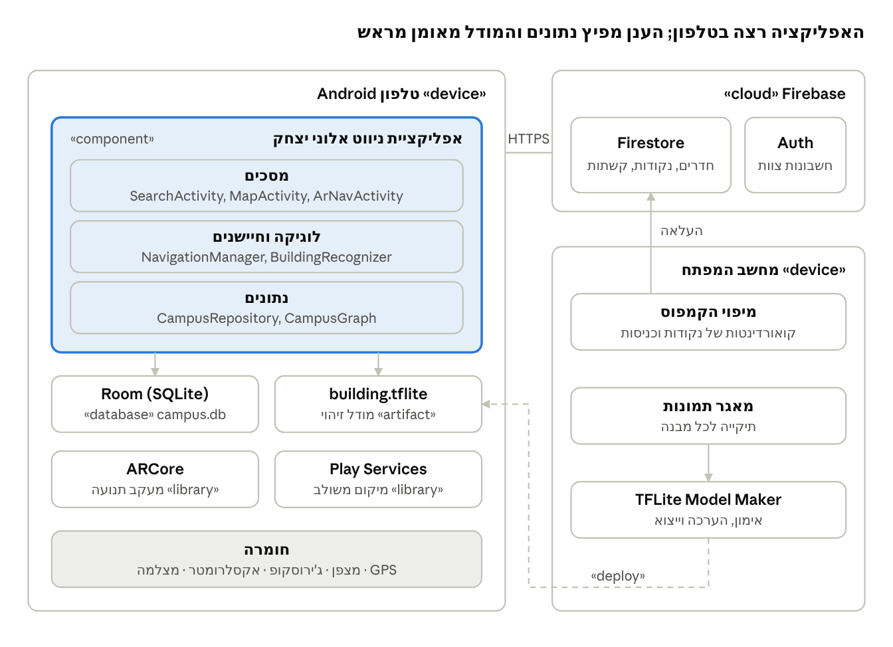
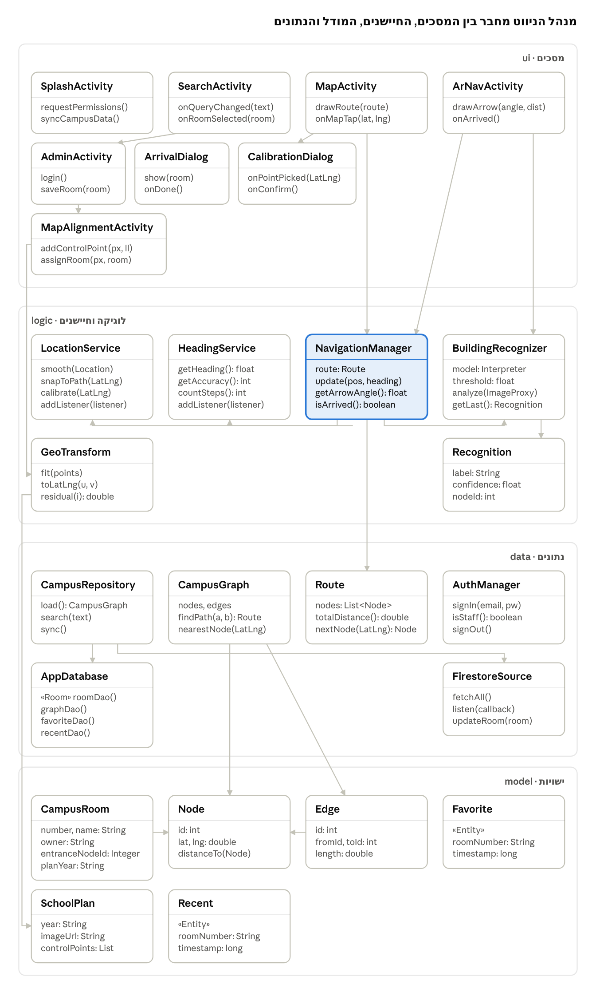
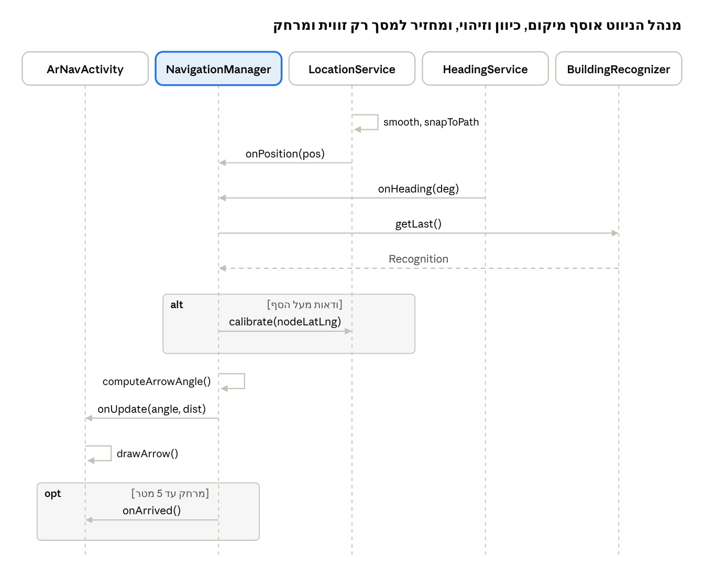
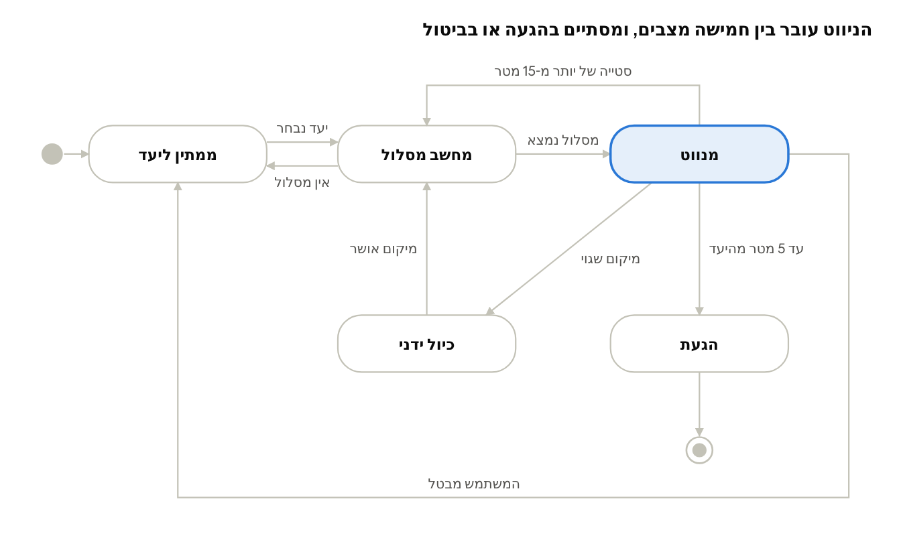
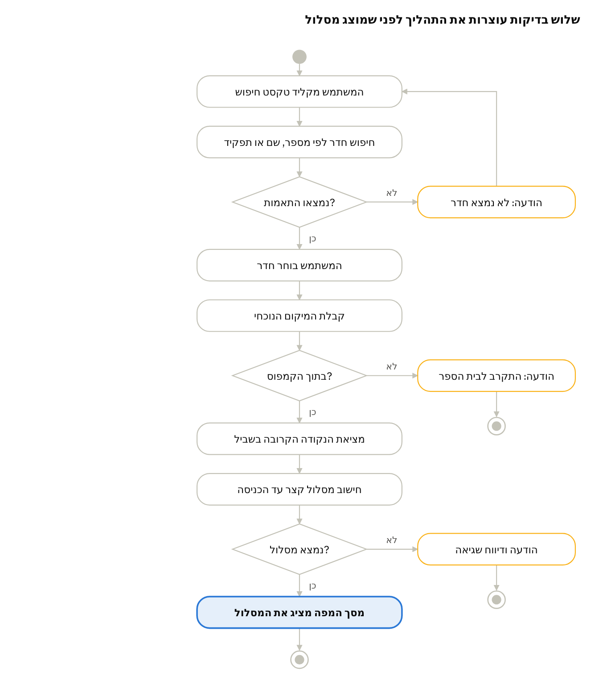
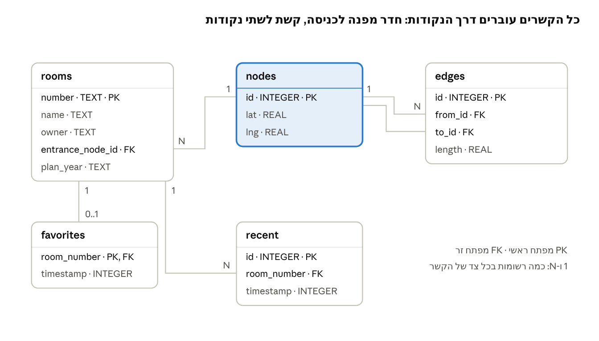

<div dir="rtl">

# מסמך תיכון (SDD) — ניווט אלוני יצחק

מסמך זה מתאר איך המערכת בנויה: הרכיבים, המחלקות, הנתונים והאלגוריתמים, ובו כל תרשימי ה-UML של הפרויקט. בתיק הפרויקט נדרשים רק תרשים המסכים ותרשים המחלקות; שאר התרשימים מובאים כדוגמה לעבודה הנדסית מלאה.

## 1. מבוא

המסמך מתרגם את הדרישות שבמסמך ה-SRS למבנה תוכנה: אילו רכיבים יש, איך הם מדברים זה עם זה, ואיך הנתונים נשמרים. כל תרשים כאן עונה על שאלה אחרת.

| תרשים | עונה על השאלה | נדרש בתיק הפרויקט |
| --- | --- | --- |
| פריסה ורכיבים | איפה כל חלק של המערכת רץ? | לא |
| מחלקות | אילו מחלקות יש ומה הקשרים ביניהן? | כן |
| רצף | מי קורא למי, ובאיזה סדר, ברגע מסוים? | לא |
| מצבים | באילו מצבים נמצא הניווט ומה מעביר ביניהם? | לא |
| פעילות | מה השלבים בתהליך, כולל החלטות? | תרשים זרימה, לפי הצורך |
| ישויות-קשרים | איך הנתונים שמורים ומקושרים? | תיאור בסיס הנתונים |
| זרימת מסכים | איך עוברים בין מסכים? | כן (בתיק הפרויקט) |

תרשים זרימת המסכים מופיע בתיק הפרויקט עצמו, בפרק המבנה והארכיטקטורה.

## 2. טכנולוגיות ושיקולי בחירה

| רכיב | טכנולוגיה | למה זו ולא אחרת |
| --- | --- | --- |
| שפה וממשק | Java + XML, Material Components (BottomNavigationView לארבעת המסכים הראשיים) | תוכנית הלימודים; מאפשר לתלמידים לקרוא כל שורה. קובצי ה-XML נבנים מעיצובי Figma (docs/design) במטלה T30 |
| מיקום | Fused Location Provider | משלב GPS, Wi-Fi ורשת ובוחר את המקור הטוב ביותר, עם חיסכון בסוללה |
| כיוון | Rotation Vector Sensor | מיזוג מוכן של מצפן, ג'ירוסקופ ואקסלרומטר, יציב יותר ממצפן לבדו |
| מצלמה | CameraX | API פשוט שמספק גם תצוגה וגם תמונות לניתוח המודל |
| שכבת AR | ARCore (מעקב תנועה בלבד) | מעגן את החץ במרחב; לא נשענים על שירות המיקום החזותי של Google, שאינו מכסה את הקמפוס |
| זיהוי מבנים | TensorFlow Lite + MobileNet | מודל קטן שרץ על הטלפון בלי רשת |
| נתונים בענן | Firebase Firestore | עדכון חי לכל המכשירים ממסך הצוות |
| נתונים בטלפון | Room (SQLite) | עבודה בלי רשת, שאילתות SQL נבדקות בקומפילציה |
| התחברות צוות | Firebase Authentication | מתחבר ישירות לכללי האבטחה של Firestore |
| מפה בדו-ממד | osmdroid (OpenStreetMap) | חינמי, בלי מפתח API ובלי חשבון חיוב, ותומך בשכבות תמונה, קווים וסמנים (סעיף 2.4) |

### 2.1 החלטות תכנון

- **ארכיטקטורה בשכבות:** מסכים ← לוגיקה וחיישנים ← נתונים. מסך לא ניגש ישירות לחיישן או לבסיס הנתונים, ולכן אפשר לבדוק את הלוגיקה בבדיקות יחידה בלי טלפון.
- **מנהל ניווט יחיד:** NavigationManager מקבל מיקום, כיוון וזיהוי מבנים ומחזיר למסך רק זווית ומרחק. כך שני מסכי הניווט משתמשים באותה לוגיקה.
- **שני בסיסי נתונים:** Firestore מקור האמת לנתוני הקמפוס, Room עותק מקומי ונתונים אישיים. בחירה בבסיס נתונים אחד בלבד הייתה תקינה; ההשוואה המלאה בסעיף 2.3.
- **שם המחלקה לחדר:** המחלקה נקראת CampusRoom ולא Room, כדי שלא תתבלבל עם ספריית Room.

### 2.2 מיפוי למחוון: מינימום מול מה שנבחר

המחוון ל-5 יח"ל דורש, מעבר לתנאי הסף (סעיפים 1–5), שני נושאים מסעיף 6, בסיס נתונים אחד (סעיף 7), ושני נושאים מסעיף 9 ושניים מסעיף 10 (סעיף 8, אפשרות 2). הפרויקט מממש יותר, כי כל נושא נוסף נובע ישירות מצורך של הניווט — לא נוסף רק כדי לצבור סעיפים.

| סעיף | מינימום | נבחר בפרויקט | למה |
| --- | --- | --- | --- |
| 6 | 2 נושאים | 6.3 Service, 6.4 מסד נתונים עם יחסים ו-JOIN, 6.9 RecyclerView | המיקום חייב לרוץ ברקע בזמן ניווט; גרף השבילים הוא נתונים עם יחסים מטבעו; תוצאות החיפוש הן רשימה ארוכה |
| 7 | בסיס נתונים אחד | Firestore וגם Room | עדכון משותף מהצוות, וניווט בלי קליטה (סעיף 2.3) |
| 9 | 2 נושאים (באפשרות 2) | 9.4 מפות, 9.6 מאזיני מיקום ותנועה, 9.11 מנוע ניווט, 9.12 למידת מכונה | ארבעתם חלקים הכרחיים של ניווט בקמפוס; 9.12 פותר את בעיית דיוק ה-GPS |
| 10 | 2 נושאים | 10.3 מצלמה, 10.6 GPS, 10.10 חיישנים, ובסיס נתונים מרוחק (נחשב כשניים) | מצלמה לחץ ולזיהוי, GPS ומצפן למיקום ולכיוון |

**גרסה מינימלית אפשרית של אותו פרויקט:** ניווט במפה בלבד (בלי AR), Room בלבד עם נתונים שנארזים באפליקציה, Service ו-RecyclerView מסעיף 6, מפות ומנוע ניווט מסעיף 9, ו-GPS וחיישנים מסעיף 10. גרסה כזו עומדת בכל הדרישות.

### 2.3 שיקולי תכנון: בחירת בסיס הנתונים

בסיס נתונים אחד מספיק כדי לעמוד בסעיף 7: Room לבד או Firebase לבד הם בחירה תקינה. בפרויקט ממומשים שניהם כדי להדגים חלוקת תפקידים בין הענן לטלפון.

| קריטריון | Room (בטלפון) | Firebase Firestore (בענן) |
| --- | --- | --- |
| איפה הנתונים | קובץ SQLite על המכשיר | שרתי Google |
| עבודה בלי אינטרנט | מלאה | מטמון מקומי; עדכונים רק כשיש חיבור |
| שיתוף בין משתמשים | אין, כל טלפון לעצמו | שינוי במכשיר אחד מגיע לכולם |
| שאילתות | SQL, נבדק בזמן קומפילציה | פעולות API על אוספים ומסמכים |
| הקמה | תלות אחת ב-Gradle | פרויקט Firebase, google-services.json וכללי אבטחה |
| עלות | חינם | תוכנית חינמית עם מכסות |
| מתאים כש... | הנתונים אישיים או קבועים | הנתונים משותפים ומתעדכנים |

- **Room לבד** מתאים כשמפת הקמפוס מגיעה עם האפליקציה ומתעדכנת רק בגרסה חדשה.
- **Firestore לבד** מתאים כשרוב הנתונים משותפים; המטמון המקומי שלו מספיק לעבודה בלי רשת ברוב המקרים.

**דוגמת שימוש ב-Room — טבלת המועדפים:**


<div dir="ltr">

```java
@Entity(tableName = "favorites")
public class Favorite {
    @PrimaryKey @NonNull public String roomNumber;
    public long timestamp;
}

@Dao
public interface FavoriteDao {
    @Insert(onConflict = OnConflictStrategy.REPLACE)
    void add(Favorite favorite);

    @Query("SELECT * FROM favorites ORDER BY timestamp DESC")
    List<Favorite> getAll();

    @Delete
    void remove(Favorite favorite);
}
```

</div>


**דוגמת שאילתת JOIN (סעיף 6.4) — חדר עם קואורדינטות הכניסה שלו:**


<div dir="ltr">

```java
@Query("SELECT r.number, r.name, n.lat, n.lng " +
       "FROM rooms r JOIN nodes n ON r.entrance_node_id = n.id " +
       "WHERE r.number = :number")
RoomWithEntrance findWithEntrance(String number);
```

</div>


**דוגמת שימוש ב-Firestore — עדכון ממסך הצוות והעתקה ל-Room:**


<div dir="ltr">

```java
FirebaseFirestore db = FirebaseFirestore.getInstance();

// מסך הצוות: עדכון בעל התפקיד של חדר 42
db.collection("rooms").document("42")
  .update("owner", "רכזת שכבה ט'");

// בכל מכשיר: האזנה לשינויים ושמירה בעותק המקומי
db.collection("rooms").addSnapshotListener((snapshot, error) -> {
    if (error != null || snapshot == null) return;
    List<RoomEntity> rooms = snapshot.toObjects(RoomEntity.class);
    executor.execute(() -> localDb.roomDao().replaceAll(rooms));
});
```

</div>


Room לא מאפשר שאילתות על ה-UI thread, ולכן הקריאות רצות ב-Executor.

### 2.4 שיקולי תכנון: שירות המפות

סעיף 9.4 במחוון הוא "GoogleMaps (או שירות דומה) ושימוש בנתוני מיקום" — נושא לבחירה, לא חובה, ו-OpenStreetMap עונה עליו בדיוק כמו Google Maps. בפרויקט נבחר osmdroid.

| קריטריון | Google Maps SDK | osmdroid (OpenStreetMap) |
| --- | --- | --- |
| עלות והרשמה | מפתח API וחשבון חיוב פעיל בכל פרויקט, תמחור לפי שימוש ([מקור](https://developers.google.com/maps/documentation/android-sdk/usage-and-billing)) | חינם, בלי מפתח ובלי חשבון |
| תמונת לוויין | כן | לא במפה הבסיסית |
| שבילי הקמפוס | לא מופיעים — רק הכבישים הראשיים | תלוי במה שמופה ב-OSM; בכל מקרה מכוסה בשכבת תוכנית בית הספר |
| שכבת תמונה על המפה | GroundOverlay | GroundOverlay |
| מפה בלי רשת | מוגבל | שמירת אריחים מראש |
| קרדיט חובה | לוגו Google | "© OpenStreetMap contributors" |

**הנימוק:** חשבון חיוב עם כרטיס אשראי הוא מכשול לתלמידים ולבית ספר. ממילא אף שירות לא מכיר את שבילי הקמפוס ואת החדרים, ולכן המידע החשוב בא משכבת תוכנית בית הספר שלנו, לא מהמפה הבסיסית. תלמיד שיש לו גישה לחשבון חיוב יכול לבחור Google Maps, ואז תמונת הלוויין עוזרת בהתאמת התוכנית.

**שכבות המפה, מלמטה למעלה:**

1. אריחי OpenStreetMap.
2. תוכנית בית הספר של השנה הנוכחית, כתמונה שקופה למחצה (GroundOverlay).
3. קו המסלול בכתום (Polyline).
4. סמן היעד ונקודת "אתה כאן" (Marker).

## 3. תרשים פריסה ורכיבים



<sub>תרשים פריסה · 3 צמתים</sub>

כל הלוגיקה רצה בטלפון, ולכן הניווט עובד בלי רשת. Firebase משמש רק להפצת נתוני הקמפוס ולהתחברות צוות. במחשב המפתח נוצרים שני דברים שנכנסים למערכת פעם אחת: נתוני המיפוי, שמועלים ל-Firestore, וקובץ המודל, שנארז באפליקציה בזמן הבנייה.

## 4. תרשים מחלקות

```mermaid
%% תרשים מחלקות — ניווט אלוני יצחק
%% להדבקה ב-https://mermaid.live
%% חצים:  -->  שימוש / שיוך   ..>  תלות (יוצר, פותח)   *--  הרכבה   o--  צבירה   <|--  ירושה

classDiagram
direction TB

namespace ui {
  class SplashActivity {
    -CampusRepository repo
    +onCreate(Bundle)
    -requestPermissions()
    -syncCampusData()
  }
  class SearchActivity {
    -CampusRepository repo
    -RecyclerView resultsList
    +onQueryChanged(String text)
    +onRoomSelected(CampusRoom room)
    +toggleFavorite(CampusRoom room)
  }
  class MapActivity {
    -NavigationManager nav
    -MapView mapView
    +drawRoute(Route route)
    +showPlanOverlay(SchoolPlan plan)
    +onMapTap(double lat, double lng)
  }
  class ArNavActivity {
    -NavigationManager nav
    -BuildingRecognizer recognizer
    +drawArrow(float angle, double dist)
    +onArrived()
  }
  class AdminActivity {
    -AuthManager auth
    -CampusRepository repo
    +login()
    +saveRoom(CampusRoom room)
  }
  class MapAlignmentActivity {
    -GeoTransform transform
    -SchoolPlan plan
    +loadPlan(String year)
    +addControlPoint(PointF px, LatLng ll)
    +assignRoom(PointF px, CampusRoom room)
    +savePlan()
  }
  class CalibrationDialog {
    +onPointPicked(LatLng point)
    +onConfirm()
  }
  class ArrivalDialog {
    +show(CampusRoom room)
    +onDone()
  }
}

namespace logic {
  class NavigationManager {
    -Route route
    -NavState state
    +update(LatLng pos, float heading)
    +getArrowAngle() float
    +getDistanceLeft() double
    +isArrived() boolean
  }
  class LocationService {
    -FusedLocationProviderClient client
    +smooth(Location loc) LatLng
    +snapToPath(LatLng p) LatLng
    +calibrate(LatLng p)
    +addListener(LocationListener l)
  }
  class HeadingService {
    -SensorManager sensors
    +getHeading() float
    +getAccuracy() int
    +countSteps() int
    +addListener(HeadingListener l)
  }
  class BuildingRecognizer {
    -Interpreter model
    -float threshold
    +analyze(ImageProxy image)
    +getLast() Recognition
  }
  class Recognition {
    +String label
    +float confidence
    +int nodeId
  }
  class GeoTransform {
    -double[] coefficients
    +fit(List~ControlPoint~ points)
    +toLatLng(double u, double v) LatLng
    +residual(int i) double
  }
}

namespace data {
  class CampusRepository {
    -AppDatabase db
    -FirestoreSource remote
    +load() CampusGraph
    +search(String text) List~CampusRoom~
    +sync()
  }
  class CampusGraph {
    -Map~Integer, Edge[]~ adjacency
    +findPath(Node from, Node to) Route
    +nearestNode(LatLng p) Node
  }
  class Route {
    +List~Node~ nodes
    +totalDistance() double
    +nextNode(LatLng p) Node
  }
  class AuthManager {
    +signIn(String email, String pw)
    +isStaff() boolean
    +signOut()
  }
  class AppDatabase {
    <<abstract>>
    +roomDao() RoomDao
    +graphDao() GraphDao
    +favoriteDao() FavoriteDao
    +recentDao() RecentDao
  }
  class FirestoreSource {
    +fetchAll()
    +listen(Callback cb)
    +updateRoom(CampusRoom room)
  }
}

namespace model {
  class CampusRoom {
    <<Entity>>
    +String number
    +String name
    +String owner
    +Integer entranceNodeId
    +String planYear
  }
  class Node {
    <<Entity>>
    +int id
    +double lat
    +double lng
    +distanceTo(Node other) double
  }
  class Edge {
    <<Entity>>
    +int id
    +int fromId
    +int toId
    +double length
  }
  class Favorite {
    <<Entity>>
    +String roomNumber
    +long timestamp
  }
  class Recent {
    <<Entity>>
    +String roomNumber
    +long timestamp
  }
  class SchoolPlan {
    +String year
    +String imageUrl
    +List~ControlPoint~ controlPoints
  }
}

%% ui
SplashActivity --> CampusRepository
SearchActivity --> CampusRepository
SearchActivity ..> AdminActivity : opens
MapActivity --> NavigationManager
MapActivity ..> CalibrationDialog : opens
MapActivity --> SchoolPlan : overlay
ArNavActivity --> NavigationManager
ArNavActivity --> BuildingRecognizer
ArNavActivity ..> ArrivalDialog : opens
AdminActivity --> AuthManager
AdminActivity --> CampusRepository
AdminActivity ..> MapAlignmentActivity : opens
MapAlignmentActivity --> GeoTransform
MapAlignmentActivity --> SchoolPlan

%% logic
NavigationManager --> LocationService
NavigationManager --> HeadingService
NavigationManager --> BuildingRecognizer
NavigationManager o-- Route
BuildingRecognizer ..> Recognition : creates
LocationService --> CampusGraph : snap to path
GeoTransform ..> SchoolPlan : control points

%% data
CampusRepository --> AppDatabase
CampusRepository --> FirestoreSource
CampusRepository ..> CampusGraph : builds
CampusGraph *-- Node
CampusGraph *-- Edge
CampusGraph ..> Route : creates
Route o-- Node
Edge --> Node : from, to
CampusRoom --> Node : entrance
AppDatabase ..> Favorite
AppDatabase ..> Recent
```



<details>
<summary>אותו תרשים בפורמט Mermaid (נבנה אוטומטית ב-GitHub, וניתן לעריכה ב-mermaid.live)</summary>

<div dir="ltr">



</div>

</details>

<sub>תרשים מחלקות · 26 מחלקות בארבע חבילות</sub>

כל חץ מסמן תלות: המחלקה שבמקור החץ משתמשת במחלקה שבקצה. החבילות מסודרות מלמעלה למטה, ותלות רצה רק כלפי מטה: מסך לעולם לא קורא לחיישן או לבסיס הנתונים בעצמו. SearchActivity ו-SplashActivity נעזרות ב-CampusRepository; החיצים שלהן הושמטו כדי שהתרשים יישאר קריא.

- **ui:** מסכים וחלונות דיאלוג — מציגים ומקבלים קלט.
- **logic:** חיישנים, המודל ומנהל הניווט — מחשבים מיקום, כיוון וזווית חץ.
- **data:** גישה לנתונים בטלפון ובענן, וחישוב המסלול.
- **model:** מחלקות נתונים פשוטות שנשמרות בבסיס הנתונים.

בתיק הפרויקט מופיעה גרסה מקוצרת של התרשים, עם המחלקות המרכזיות בלבד.

## 5. תרשים רצף



<sub>תרשים רצף · מחזור עדכון אחד של החץ</sub>

התרשים מראה מחזור אחד, שחוזר כמה פעמים בשנייה. קו מקוטע עם חץ הוא ערך מוחזר; המסגרת alt מתבצעת רק כשהמודל בטוח בזיהוי, והמסגרת opt רק כשהמשתמש הגיע. אותו מחזור משרת גם את MapActivity, שמציג את המיקום על המפה במקום חץ.

## 6. תרשים מצבים



<sub>תרשים מצבים · 5 מצבי ניווט</sub>

NavigationManager שומר את המצב הנוכחי במשתנה מסוג enum, וכל אירוע בתרשים הוא קריאה לפעולה שמעבירה מצב. כך מסך המצלמה ומסך המפה תמיד מציגים את אותו מצב, ואפשר לבדוק כל מעבר בבדיקת יחידה.

## 7. תרשים פעילות



<sub>תרשים פעילות · חיפוש יעד וחישוב מסלול</sub>

תרשים פעילות דומה לתרשים זרימה, ומתאים לדרישה בתיק הפרויקט לצרף תרשים זרימה לזימון פעולות סדרתי. כל מעבר לענף "לא" הוא מקרה קצה מהדרישה FR-03 במסמך הדרישות, ולכל אחד מהם צריכה להיות בדיקה.

## 8. מודל נתונים



<sub>תרשים ישויות-קשרים · טבלאות Room</sub>

חמש טבלאות ב-Room. הטבלאות rooms, nodes ו-edges הן עותק של Firestore; favorites ו-recent קיימות רק בטלפון.

| טבלה | מחלקה | מפתח | קשרים |
| --- | --- | --- | --- |
| rooms | `CampusRoom` | `number` — מספר החדר כפי שהוא מודפס בתרשים ("36", "ש36"), קבוע משנה לשנה | `entrance_node_id` → nodes; ריק עד שהכניסה ממופה |
| nodes | `Node` | `id` | — |
| edges | `Edge` | `id` | `from_id`, `to_id` → nodes |
| favorites | `Favorite` | `room_number` | → rooms; נמחק עם החדר |
| recent | `Recent` | `id` | `room_number` → rooms; שורה אחת לכל חדר, 10 האחרונים |

`name` הוא מה שיש בחדר השנה (כיתה ט2, ספרייה), ו-`plan_year` הוא שנת התרשים שממנה הגיע השיבוץ. כך שיבוץ חדש בכל שנה משנה שדות, ולא את המפתח.

**סנכרון:** `GraphDao.replaceCampus` מחליף את העותק בטרנזקציה אחת. חדרים ונקודות מתעדכנים במקום (Upsert) ולא נמחקים ונוצרים מחדש, ולכן המועדפים והחיפושים האחרונים נשמרים. חדר שירד מהנתונים נמחק, והמועדף שלו איתו (ON DELETE CASCADE). אם משהו נכשל באמצע, שום דבר לא נשמר.

**השאילתות:** `RoomDao` (חיפוש, ו-JOIN עם nodes — סעיף 2.3), `GraphDao`, `FavoriteDao`, `RecentDao`. הקוד ב-`app/app/src/main/java/il/org/ay/navigation/data`, והבדיקות שלו ב-`AppDatabaseTest`.

### 8.1 המבנה ב-Firestore

Firestore שומר מסמכים באוספים ולא טבלאות, ולכן הקשרים נשמרים כמזהים בתוך המסמך.

| אוסף | מזהה מסמך | שדות | מי כותב |
| --- | --- | --- | --- |
| rooms | מספר החדר ("36", "ש36") | name, owner, entranceNodeId, planYear | איש צוות, מפתח |
| nodes | מספר הנקודה ("12") | lat, lng | מפתח |
| edges | מספר הקשת ("5") | fromId, toId, length | מפתח |
| meta | version | number, updatedAt | מעודכן בכל העלאה ובכל שינוי |

שמות השדות ב-Firestore הם שמות השדות במחלקות Java (camelCase), ולכן אותה מחלקה משמשת גם כמסמך Firestore וגם כשורה ב-Room (שם העמודה ב-snake_case, דרך `@ColumnInfo`). מזהה המסמך הוא המפתח של הטבלה. דוגמה למסמך:

<div dir="ltr">

```
rooms/36  →  { name: "ט2", owner: "מחנכת ט2", entranceNodeId: 14, planYear: "tashpaz" }
nodes/14  →  { lat: 32.49012, lng: 34.95231 }
edges/5   →  { fromId: 14, toId: 15, length: 23.4 }
meta/version → { number: 3, updatedAt: <timestamp> }
```

</div>

הנתונים מועלים מהקבצים ב-`campus-data/` בסקריפט `upload_to_firestore.py`, אחרי בדיקת התקינות של `validate.py`.

### 8.2 כללי אבטחה


<div dir="ltr">

```
rules_version = '2';
service cloud.firestore {
  match /databases/{db}/documents {
    match /{collection}/{doc} {
      allow read: if true;
      allow write: if request.auth != null
                   && request.auth.token.staff == true;
    }
  }
}
```

</div>


כל אחד קורא את נתוני הקמפוס, ורק משתמש מחובר עם סימון צוות כותב (NFR-10).

## 9. אלגוריתמים

### 9.1 מסלול קצר: Dijkstra

הגרף מיוצג כרשימת שכנויות, ומשקל כל קשת הוא אורכה במטרים. האלגוריתם מתחיל מהנקודה הקרובה למשתמש ומרחיב כל פעם את הנקודה הלא-מבוקרת הקרובה ביותר, בעזרת תור עדיפויות (PriorityQueue). כשנקודת הכניסה של היעד יוצאת מהתור, המסלול משוחזר אחורה לפי מערך "הקודם".

- **סיבוכיות:** O((V + E) log V), כש-V מספר הנקודות ו-E מספר הקשתות.
- **בדיקות יחידה:** גרף של 6 נקודות עם מסלולים שחושבו ידנית, כולל יעד שאין אליו מסלול.

### 9.2 מרחק בין שתי נקודות

במרחקים של מאות מטרים אפשר להתייחס לכדור הארץ כמישור. ההמרה ממעלות למטרים:


<div dir="ltr">

```math
d = R \sqrt{\left(\Delta\varphi\right)^2 + \left(\cos\bar{\varphi} \cdot \Delta\lambda\right)^2}
```

</div>


כש-R רדיוס כדור הארץ (6,371,000 מטר), φ קו הרוחב ו-λ קו האורך ברדיאנים, ו-φ̄ הממוצע של שני קווי הרוחב.

### 9.3 הצמדה לשביל

לכל קשת מחשבים את ההיטל של מיקום ה-GPS על הקטע, ובוחרים את הקשת שההיטל עליה הקרוב ביותר. ההיטל של נקודה P על קטע AB:


<div dir="ltr">

```math
t = \mathrm{clamp}\left(\frac{(P - A) \cdot (B - A)}{\lVert B - A \rVert^2},\ 0,\ 1\right), \qquad P' = A + t\,(B - A)
```

</div>


אם המרחק מ-P ל-P' גדול מ-15 מטר, המשתמש כנראה סטה, והמסלול מחושב מחדש.

### 9.4 זווית החץ

הכיוון מהמשתמש לנקודה הבאה (bearing), נמדד ממעלות צפון בכיוון השעון:


<div dir="ltr">

```math
\theta = \operatorname{atan2}\left(\sin\Delta\lambda \cos\varphi_2,\ \cos\varphi_1 \sin\varphi_2 - \sin\varphi_1 \cos\varphi_2 \cos\Delta\lambda\right)
```

</div>


זווית החץ על המסך היא ההפרש בין הכיוון לנקודה לבין כיוון הטלפון:


<div dir="ltr">

```math
\alpha = \left(\theta - \text{heading} + 360\right) \bmod 360
```

</div>


כדי שהחץ לא ירעד, α עובר החלקה: כל ערך חדש משוקלל עם הערך הקודם.

## 10. צינור למידת המכונה

המודל מאומן פעם אחת מחוץ לאפליקציה, נארז בתוכה כקובץ ‎.tflite, ורץ על הטלפון בלי רשת.

1. **איסוף:** צילום כל מבנה מכמה זוויות ומרחקים, בבוקר ובצהריים, ובכמה ימים שונים. תיקייה לכל תווית, ותיקיית "אחר" לשבילים, עצים ושמיים.
2. **הכנה:** מחיקת תמונות מטושטשות או עם אנשים מזוהים; חלוקה אקראית לאימון, אימות ובדיקה ביחס 70/15/15, כך שתמונות מאותו צילום רציף לא יתפצלו בין הקבוצות.
3. **הגדלת נתונים:** סיבוב קל, שינוי בהירות וחיתוך אקראי בזמן האימון, כדי שהמודל לא ילמד בעל-פה זווית אחת.
4. **אימון:** Transfer Learning על MobileNetV2 שאומן מראש, בקלט של 224×224 פיקסלים. רק השכבה האחרונה מאומנת מחדש.
5. **הערכה:** דיוק ומטריצת בלבול על קבוצת הבדיקה; היעד 85% לפחות (NFR-05). מבנים שמתבלבלים מקבלים עוד תמונות.
6. **ייצוא:** המרה ל-TensorFlow Lite עם כימות (quantization), כדי להקטין את הקובץ ולהאיץ את ההרצה.
7. **שילוב:** BuildingRecognizer מקבל תמונות מ-ImageAnalysis של CameraX, מריץ את המודל כמה פעמים בשנייה, ומחזיר תווית ורמת ודאות.

### 10.1 איך הזיהוי מתקן את המיקום

| מצב | פעולה |
| --- | --- |
| ודאות מעל הסף, המבנה שזוהה קרוב למיקום הנוכחי | המיקום מוצמד לנקודה בשביל מול המבנה |
| ודאות מעל הסף, המבנה רחוק מהמיקום הנוכחי | מתעלמים; כנראה רואים מבנה מרוחק |
| ודאות מתחת לסף, או תווית "אחר" | מתעלמים |

הסף נקבע לפי מטריצת הבלבול בשלב ההערכה, ולא מראש.

## 11. התאמת תוכנית בית הספר למפה

בכל שנה מתפרסם תרשים מבנה חדש (PDF) עם שיבוץ כיתות מעודכן. איש צוות מתאים אותו למפה פעם אחת בכלי MapAlignmentActivity, ומשייך את החדרים, בלי לשנות קוד.

### 11.1 תהליך העבודה של איש הצוות

1. **הכנת התמונה:** את עמוד ה-PDF ממירים לתמונת PNG ומעלים לאתר GitHub Pages של הפרויקט, בתיקייה של אותה שנה. אחסון ב-Firebase Storage דורש תוכנית בתשלום (Blaze) ([מקור](https://firebase.google.com/docs/storage/faqs-storage-changes-announced-sept-2024)), ולכן התמונה נשמרת כקובץ סטטי.
2. **נקודות עיגון:** בכלי, איש הצוות נוגע בנקודה בתרשים (למשל פינת מבנה), ואז בנקודה המתאימה במפה — או עומד בה פיזית ולוחץ "אני עומד כאן" כדי להשתמש ב-GPS. צריך לפחות 3 נקודות, רצוי 4–6 מפוזרות בקצוות הקמפוס.
3. **תצוגה מקדימה:** האפליקציה מחשבת את ההתאמה ומציגה את התרשים מעל המפה; איש הצוות בודק שהמבנים יושבים במקומם ומוסיף נקודות אם לא.
4. **שיוך חדרים:** נגיעה בכניסה לחדר בתרשים פותחת טופס עם מספר, שם ובעל תפקיד. הנקודה מומרת לקו רוחב ואורך ונשמרת כנקודת הכניסה של החדר.
5. **שמירה:** ההתאמה והחדרים נכתבים ל-Firestore, ומספר הגרסה עולה כך שכל המכשירים מסתנכרנים.

### 11.2 המתמטיקה: התאמה אפינית

המרה מנקודה בתרשים (u, v) בפיקסלים לנקודה על המפה (x, y) במטרים מקומיים היא העתקה אפינית עם 6 נעלמים:


<div dir="ltr">

```math
x = a\,u + b\,v + c, \qquad y = d\,u + e\,v + f
```

</div>


כל נקודת עיגון נותנת שתי משוואות, ולכן 3 נקודות מספיקות לפתרון מדויק. עם יותר נקודות פותרים בשיטת הריבועים הפחותים, מה שמקטין את השפעת שגיאת GPS בנקודה אחת:


<div dir="ltr">

```math
\min_{a,\dots,f} \sum_{i=1}^{n} \left(a u_i + b v_i + c - x_i\right)^2 + \left(d u_i + e v_i + f - y_i\right)^2
```

</div>


המרה בין מטרים מקומיים לקו רוחב ואורך נעשית בקירוב המישורי מסעיף 9.2. השארית של כל נקודת עיגון (המרחק בין המיקום המחושב למיקום שסומן) מוצגת לאיש הצוות, ונקודה עם שארית גדולה מסומנת כחשודה.

**הגבלה:** GroundOverlay יודע רק להזיז, לסובב ולשנות גודל, ולא לעוות. לכן לתצוגה משתמשים בהתאמה של מיקום, זווית וקנה מידה, ואילו להמרת נקודות החדרים משתמשים בהתאמה האפינית המלאה, המדויקת יותר.

### 11.3 הנתונים

| אוסף ב-Firestore | מזהה מסמך | שדות |
| --- | --- | --- |
| plans | שנת הלימודים ("tashpaz") | imageUrl, controlPoints (רשימת זוגות פיקסל–קואורדינטה), transform (6 המקדמים), bearing, active |
| rooms | מספר החדר | name, owner, entranceNodeId, planYear |

תוכנית אחת בלבד מסומנת active. תוכניות של שנים קודמות נשמרות, כך שאפשר לחזור אליהן אם ההתאמה החדשה שגויה.

</div>
