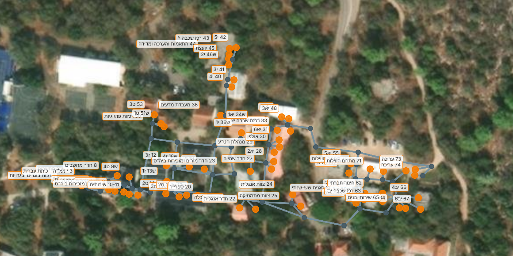

<div dir="rtl">

# נתוני הקמפוס

הקמפוס מיוצג בשלושה קובצי CSV בתיקייה [`campus-data`](https://github.com/Aloney-Yitzchak/aloney-navigation/tree/main/campus-data): נקודות על השבילים, השבילים ביניהן, והחדרים. הקבצים נבדקים בסקריפט, מוצגים על מפה, ומועלים ל-Firestore. מהם האפליקציה בונה את הגרף שעליו רץ Dijkstra (מסמך התיכון, סעיף 9.1).



<sub>מפת הקמפוס · 117 נקודות (64 כניסות), 126 שבילים, 1,146 מ' שבילים · מופתה מתמונת לוויין ב-24.10.2026</sub>

## הקבצים

| קובץ | עמודות | הערות |
| --- | --- | --- |
| `nodes.csv` | `id,lat,lng,kind,label` | `kind` הוא `entrance` (כניסה לחדר) או `junction` (צומת שבילים). `label` טקסט חופשי לעזרה, למשל "כניסה 20" |
| `edges.csv` | `from_id,to_id,length_m` | השבילים דו-כיווניים, ולכן כל שביל נשמר פעם אחת. `length_m` מחושב בסקריפט ולא מוקלד |
| `rooms.csv` | `number,name,owner,entrance_node_id,plan_year` | `number` הוא מספר החדר כפי שמודפס בתרשים ("36", "ש36"). `entrance_node_id` ריק עד שהכניסה ממופה |

`kind` ו-`label` נשארים רק בקובץ, לעזרה במיפוי. לאפליקציה ולענן עולים `id`, `lat` ו-`lng` בלבד.

## רשימת החדרים

`rooms.csv` נבנה מתרשים בית הספר תשפ"ז: 64 חדרים, ממספר 1 עד 74 (חלק מהמספרים לא מופיעים בתרשים). לגבי התרשים:

- לחלק מהחדרים יש ש לפני המספר (ש9, ש13…). המספר נשמר בדיוק כפי שמודפס, עם האות.
- לשני חדרי השירותים הראשונים יש מספר כפול, 10-11, והוא נשמר כמזהה אחד.
- `name` הוא מה שיש בחדר השנה: כיתה (ט2), חדר מקצועי (מעבדת מדעים) או תפקיד (רכזת שכבה ח'). `owner` מולא רק כשהחדר שייך לבעל תפקיד.
- **שמות פרטיים של אנשי צוות לא נכנסו לקובץ**, כי המאגר ציבורי. אם רוצים לחפש "יועצת נטע", מוסיפים את השם ממסך הצוות (T24), והוא נשמר רק ב-Firestore.
- חדרים בלי מספר בתרשים (מחסן ליד הספרייה, "ענת אברהם וטיפול") לא נכנסו. אפשר להוסיף אותם עם מספר חדש.

## מיפוי מהמחשב, על תמונת לוויין

הגרסה הראשונה של המפה נבנתה מהמחשב, על שכבת הלוויין ב-`preview.html`. היא נבדקת אחר כך בסיור בשטח, שמתקן את הנקודות לפי ה-GPS של הטלפון.

1. פותחים את `campus-data/preview.html` ב-Chrome, ישירות מהקובץ, ובוחרים את שלושת קובצי ה-CSV. אפשר גם לפתוח דרך `python -m http.server`.
2. עוברים לשכבת "לוויין" (בפינת המפה), ומקרבים לבניין.
3. **כניסות:** בוחרים חדר ברשימה "חדרים בלי כניסה", ולוחצים על הדלת שלו במפה. אם כמה חדרים נכנסים מאותה דלת, בוחרים את החדר הבא ולוחצים על נקודת הכניסה הקיימת.
4. **צמתים ושבילים:** לוחצים על המפה בכל פיצול או פנייה של שביל. כדי לחבר שתי נקודות בשביל, לוחצים על נקודה ואחר כך על השנייה.
5. **בדיקה:** הפאנל מראה בכל רגע נקודות מנותקות ושבילים ארוכים מ-80 מ'. כשאין שגיאות והרשימה ריקה, לוחצים "הורדת 3 הקבצים".

כל שינוי נשמר בדפדפן כטיוטה. אם הדף נסגר באמצע, בפתיחה הבאה מופיע כפתור "שחזור הטיוטה".

## איך ממפים: סיור בשטח

**מה צריך:** טלפון עם אפליקציה ששומרת נקודות עם שם ומייצאת קובץ GPX או CSV, למשל GPS Logger או OsmAnd (נקודות מועדפות). כ-2–3 שעות, ביום בהיר.

**לפני הסיור (מומלץ):** פותחים את `preview.html` בשכבת הלוויין ומסמנים מראש את הצמתים שרואים מלמעלה. בשטח רק מאמתים ומוסיפים את הכניסות.

**לכל נקודה:**

1. עומדים בדיוק במקום: בפתח החדר, או במרכז הצומת.
2. מחכים שהדיוק באפליקציה יהיה טוב מ-5 מטר.
3. שומרים נקודה עם שם לפי הכלל:

| מה | שם הנקודה | דוגמה |
| --- | --- | --- |
| כניסה לחדר אחד | `כניסה` ואחריו מספר החדר | `כניסה 20` |
| כניסה משותפת לכמה חדרים | `כניסה` ואחריו כל המספרים | `כניסה 12 ש13` |
| צומת שבילים | `צומת`, ואפשר להוסיף תיאור | `צומת ליד הספרייה` |

4. אם הדיוק לא ירד מתחת ל-5 מטר, שומרים את אותה נקודה פעמיים באותו שם. הסקריפט ימצע את שתי ההקלטות.

**כמה צמתים:** בכל מקום שבו שביל מתפצל או מתעקם, ולפחות כל 80 מטר בשביל ישר. שביל ארוך בלי צמתים יסומן כאזהרה.

## אחרי הסיור

<div dir="ltr">

```bash
cd campus-data
python gpx_to_nodes.py walk.gpx                        # תצוגה מקדימה: מה ייכנס
python gpx_to_nodes.py walk.gpx --write --link-rooms   # הוספה ל-nodes.csv ומילוי הכניסות ב-rooms.csv
python -m http.server 8000                              # ואז http://localhost:8000/preview.html
```

</div>

ב-`preview.html`, במצב עריכה:

- לחיצה על נקודה ואז על נקודה אחרת יוצרת שביל ביניהן, ולחיצה חוזרת מוחקת אותו.
- לחיצה על המפה מוסיפה צומת, גרירה מזיזה נקודה, ולחיצה כפולה עורכת את הסוג והתווית.
- בסוף מורידים את `nodes.csv` ו-`edges.csv` ומחליפים את הקבצים בתיקייה.

ואז בודקים:

<div dir="ltr">

```bash
python validate.py --write --complete
```

</div>

`--write` ממלא את `length_m`, ו-`--complete` דורש שלכל חדר תהיה כניסה. הסקריפט בודק:

- מזהים כפולים או חסרים;
- שהגרף קשיר: יש מסלול בין כל שתי נקודות;
- שבילים ארוכים מ-80 מטר, שכנראה חסר בהם צומת;
- שכל `entrance_node_id` קיים ומסומן `entrance`.

המרחק מחושב לפי מסמך התיכון, סעיף 9.2, באותה נוסחה כמו `Node.distanceTo` באפליקציה.

## בדיקות

<div dir="ltr">

```bash
cd campus-data && python -m unittest -v
```

</div>

הבדיקות משתמשות בערכים שחושבו ידנית: 0.001° צפונה = ‎111.195 מ', ו-0.001° מזרחה בקו הרוחב של הקמפוס = ‎93.791 מ'. הן בודקות גם קשירות, כפילויות, שבילים ארוכים וכניסות שגויות, וזה החצי המוקדם של בדיקת הקבלה AT-03.

## פרויקט Firebase

| | |
| --- | --- |
| מזהה הפרויקט | `aloney-navigation` (בארגון a-y.org.il) |
| תוכנית | Spark, חינמית |
| Firestore | מסד `(default)`, Standard edition, באזור **me-west1 (תל אביב)**. אי אפשר לשנות את האזור אחרי היצירה |
| התחברות | Email/Password, לאנשי צוות בלבד (T24) |
| אפליקציית Android | `il.org.ay.navigation` רשומה. את `google-services.json` מורידים ב-Project settings ← Your apps, ושמים ב-`app/app/` (לא נכנס ל-git) |
| כבוי | Google Analytics ו-Gemini in Firebase: האפליקציה לא צריכה אותם, והמשתמשים הם תלמידים |

## כללי האבטחה

הכללים ב-[`firestore.rules`](https://github.com/Aloney-Yitzchak/aloney-navigation/blob/main/firestore.rules) (מסמך התיכון, סעיף 8.2): כל אחד קורא, ורק משתמש מחובר עם הסימון `staff == true` כותב (NFR-10). הקובץ במאגר הוא המקור. כשמשנים אותו, מעתיקים אותו ל-Firebase Console ← Firestore ← Rules ומפרסמים, או מריצים `firebase deploy --only firestore:rules`.

הכללים נבדקים באמולטור של Firestore, בלי לגעת בפרויקט האמיתי:

<div dir="ltr">

```bash
cd firestore-tests
npm install
npm test              # 6 בדיקות: קריאה לכולם, כתיבה רק לצוות
npm run test:upload   # סקריפט ההעלאה מול האמולטור
```

</div>

## העלאת הנתונים ל-Firestore

הסקריפט מתחבר עם ההרשאה של מי שמריץ אותו (Application Default Credentials), ולכן **לא צריך קובץ מפתח**. הדרך הפשוטה היא Google Cloud Shell: לוחצים על כפתור ה-`>_` בפינה העליונה של Firebase Console, ומריצים:

<div dir="ltr">

```bash
git clone https://github.com/Aloney-Yitzchak/aloney-navigation
cd aloney-navigation/campus-data
pip install -r requirements.txt
python upload_to_firestore.py --dry-run   # בדיקה, ומה ישתנה
python upload_to_firestore.py             # העלאה
```

</div>

מהמחשב האישי עובדים באותו אופן, אחרי `gcloud auth application-default login` חד-פעמי. אפשר גם להשתמש במפתח של חשבון שירות דרך `GOOGLE_APPLICATION_CREDENTIALS`, אבל אז הקובץ חייב להישמר **מחוץ למאגר**: כל מי שמחזיק אותו יכול לכתוב לכל הפרויקט.

- הסקריפט מריץ קודם את הבדיקות של `validate.py`, ולא מעלה נתונים לא תקינים או חדר בלי כניסה. לפני שהמיפוי הושלם אפשר להוסיף `--allow-unmapped`, כדי שהחיפוש יעבוד כבר עכשיו.
- מסמכים שנמחקו מהקבצים נמחקים גם מ-Firestore.
- `meta/version` מתעדכן אחרון, ולכן הטלפונים מסנכרנים רק אחרי שההעלאה הושלמה (T08).
- אחרי שאנשי הצוות מתחילים לערוך חדרים מהאפליקציה (T24), מעלים רק את המפה: `--only nodes --only edges`, כדי לא לדרוס את העריכות שלהם.

## הרשאת כתיבה לאיש צוות

1. איש הצוות נרשם עם מייל וסיסמה: במסך הצוות באפליקציה (T24), או שמוסיפים אותו ב-Console ← Authentication ← Users.
2. מריצים, ב-Cloud Shell או אחרי `gcloud auth application-default login`:

<div dir="ltr">

```bash
python set_staff_claim.py teacher@a-y.org.il            # מתן הרשאה
python set_staff_claim.py teacher@a-y.org.il --remove   # הסרה
python set_staff_claim.py --list                        # מי מורשה
```

</div>

ההרשאה מגיעה לטלפון בהתחברות הבאה, או תוך שעה לכל היותר.

</div>
