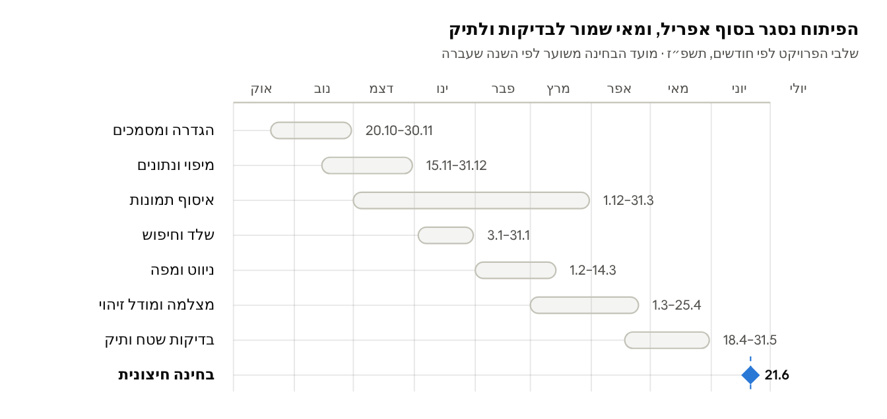
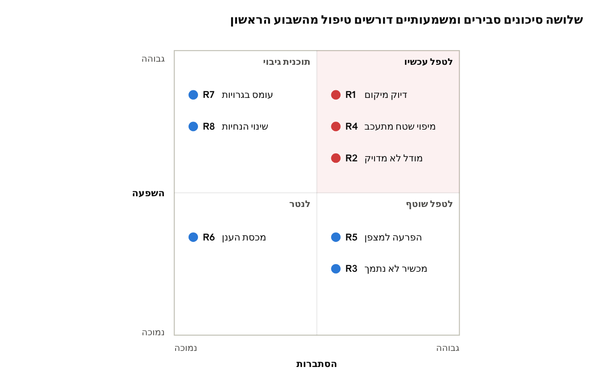

# תוכנית ניהול פרויקט — ניווט אלוני יצחק

מסמך זה מתאר מתי ואיך הפרויקט נבנה: לוח זמנים, מטלות, סיכונים ותהליך העבודה. הוא אינו חלק מתיק הפרויקט שמשרד החינוך דורש, ומובא כדוגמה לניהול פרויקט תוכנה.

## 1. לוח זמנים

לוח זמנים · 7 שלבים ובחינה

איסוף התמונות למודל מתחיל כבר בדצמבר ורץ במקביל לשלבים אחרים, כדי שיהיו תמונות מעונות וממזג אוויר שונים. כל שלב הוא Milestone ב-GitHub עם תאריך הסיום שלו.

## 2. פירוק מטלות

הפרויקט מפורק ל-31 מטלות בשישה שלבים, כ-144 שעות עבודה. כל מטלה הופכת ל-Issue ב-GitHub, וכל שלב ל-Milestone. שלב ההגדרה הושלם באוקטובר 2026: המסמכים (T01–T03) ועיצוב המסכים (T27). בעקבות סקירת העיצוב נוספה מטלה T30, הפיכת העיצובים לקובצי XML.

**שלב הנתונים (M2) הושלם ב-24.10.2026**, יותר מחודשיים לפני היעד:
- **T07** הוקדמה ל-M2 (החלטה #11), כדי שמחלקות הנתונים של T04 ייבנו בפרויקט שמתקמפל.
- **T05:** המפה נבנתה מתמונת לוויין במקום בסיור בשטח (64 חדרים, 117 נקודות, 126 שבילים). הבדיקה בשטח נוספה כמטלה **T05b** ב-M4, לפני שהניווט מסתמך על המפה.
- **T06:** הנתונים הועלו ל-Firestore מ-Cloud Shell, בלי קובץ מפתח.

| שלב | יעד | מצב |
| --- | --- | --- |
| M1 · הגדרה ומסמכים | 30.11.2026 | הושלם 21.10.2026 |
| M2 · מיפוי ונתונים | 31.12.2026 | הושלם 24.10.2026 |
| M3 · שלד וחיפוש | 31.01.2027 | הבא בתור |
| M4–M6 | 14.03–31.05.2027 | מתוכנן |

| מס' | מטלה | שלב | דרישה | שעות |
| --- | --- | --- | --- | --- |
| T01 | מבוא לתיק הפרויקט | הגדרה | — | 4 |
| T02 | מסמך דרישות (SRS) | הגדרה | — | 5 |
| T03 | מסמך תיכון ותרשימי UML | הגדרה | — | 8 |
| T04 | מבנה הנתונים ב-Firestore וב-Room | נתונים | FR-09 | 3 |
| T05 | מיפוי שטח: קואורדינטות לכניסות ולצמתי שבילים | נתונים | FR-03 | 6 |
| T05b | בדיקת מפת הקמפוס בשטח ותיקון לפי GPS | ניווט | FR-03 | 2 |
| T06 | הקמת Firebase והעלאת נתוני הקמפוס | נתונים | FR-09 | 3 |
| T07 | פרויקט Android, הרשאות ומסך פתיחה | שלד | FR-12 | 3 |
| T08 | Room וסנכרון מ-Firestore | שלד | FR-09 | 5 |
| T09 | מסך חיפוש | שלד | FR-01 | 3 |
| T10 | מועדפים וחיפושים אחרונים | שלד | FR-02 | 2 |
| T11 | שירות מיקום והחלקה | ניווט | FR-03 | 4 |
| T12 | שירות כיוון וצעדים | ניווט | FR-04 | 3 |
| T13 | גרף הקמפוס ו-Dijkstra עם בדיקות יחידה | ניווט | FR-03 | 5 |
| T14 | הצמדה לשביל | ניווט | FR-03 | 4 |
| T15 | מסך מפה | ניווט | FR-05 | 5 |
| T16 | מסך מצלמה עם CameraX | AR ו-AI | FR-04 | 3 |
| T17 | חץ, מרחק ונקודה הבאה על המצלמה | AR ו-AI | FR-04 | 5 |
| T18 | עיגון ב-ARCore ומצב גיבוי | AR ו-AI | FR-11 | 6 |
| T19 | זיהוי הגעה | AR ו-AI | FR-06 | 2 |
| T20 | איסוף ותיוג תמונות מבנים | AR ו-AI | FR-07 | 8 |
| T21 | אימון והערכת המודל | AR ו-AI | FR-07 | 6 |
| T22 | שילוב המודל ותיקון מיקום | AR ו-AI | FR-07 | 5 |
| T23 | כיול ידני | שיפורים | FR-08 | 3 |
| T24 | התחברות צוות ומסך עריכה | שיפורים | FR-10 | 5 |
| T25 | בדיקות שטח ותיקונים | שיפורים | — | 6 |
| T26 | השלמת תיק הפרויקט ומדריך למשתמש | שיפורים | — | 8 |
| T27 | עיצוב 9 המסכים ב-Stitch וב-Figma, לפי מדריך העיצוב | הגדרה | — | 4 |
| T28 | כלי התאמת מפה שנתית ושיוך חדרים | שיפורים | FR-13 | 8 |
| T29 | שכבות המפה: osmdroid, תוכנית בית הספר, מסלול וסמנים | ניווט | FR-05 | 4 |
| T30 | קובצי XML לכל המסכים לפי עיצובי Figma | שלד | — | 6 |

המטלות הכבדות ביותר הן T03, T20 ו-T26, ולכן הן מתחילות מוקדם בשלב שלהן.

## 3. ניהול סיכונים

מפת סיכונים · הסתברות מול השפעה

| מזהה | סיכון | צעד מניעה | תוכנית גיבוי |
| --- | --- | --- | --- |
| R1 | שגיאת GPS גדולה מדי ליד מבנים | הצמדה לשביל, החלקה וזיהוי מבנים | כיול ידני (FR-08) |
| R2 | המודל לא מגיע ל-85% דיוק | איסוף תמונות מוקדם, בכמה מועדים | צמצום למבנים שקל לזהות |
| R3 | ARCore לא נתמך במכשירי הנבחנים | בדיקת תמיכה במטלה T07: ה-Galaxy S22 נתמך | מצב גיבוי לפי מצפן (FR-11) |
| R4 | מיפוי השטח לוקח יותר זמן | מיפוי מתמונת לוויין (בוצע ב-M2), ובדיקה בשטח ב-T05b | פריסה ראשונה על חלק מהקמפוס |
| R5 | הפרעה מגנטית משבשת את המצפן | שימוש ב-Rotation Vector וב-ARCore | בקשת כיול בתנועת "שמונה" |
| R6 | חריגה ממכסת Firebase החינמית | סנכרון רק כשהגרסה משתנה | עבודה מהעותק המקומי |
| R7 | עומס בגרויות באביב | סיום הפיתוח העיקרי עד אפריל | ויתור על דרישות Should |
| R8 | שינוי בהנחיות או במחוון של משרד החינוך | מעקב אחרי פורטל המגמה | עדכון טבלת התכולות בתיק |

## 4. עבודה עם בינה מלאכותית בפיתוח

את רוב הקוד כותב כלי בינה מלאכותית (Claude Code); המפתח מגדיר, מתכנן, בודק ומחליט. זה נפרד ממודל זיהוי המבנים, שהוא רכיב AI בתוך המוצר עצמו.

| שלב | המפתח | הבינה המלאכותית |
| --- | --- | --- |
| הגדרה | כותב את הדרישות ובוחר מה בפנים ומה בחוץ | מציעה דרישות שנשכחו ומצביעה על סתירות |
| תכנון | מאשר את התרשימים | מציעה מבנה מחלקות ראשוני |
| מימוש | מפרק למשימות קטנות וכותב לכל אחת Issue ברור | כותבת קוד ופותחת Pull Request |
| בדיקה | קורא כל PR, מריץ על טלפון בקמפוס ומבקש תיקונים | מתקנת לפי ההערות וכותבת בדיקות יחידה |
| תיעוד | מחליט מה נכנס לתיק | מנסחת טיוטות שהמפתח עורך |

### 4.1 כללי עבודה

- **שום קוד לא נכנס ל-main בלי שהמפתח קרא אותו.** כל שינוי עובר דרך Pull Request.
- **Issue אחד = משימה אחת.** משימה גדולה מפורקת לפני שנותנים אותה לבינה.
- **בדיקה בשטח מנצחת הסבר משכנע.** קוד ניווט נבדק בהליכה בין המבנים, לא רק באמולטור.
- **הפרומפטים נשמרים.** בתיאור כל PR מופיע הפרומפט שהוביל אליו.

### 4.2 מה דורשות הנחיות משרד החינוך

- קטע קוד משמעותי שנוצר בכלי בינה מלאכותית מסומן בתיק בצורה ברורה ומודגשת.
- בביבליוגרפיה מופיע קישור ציבורי פעיל לשיחה, ומספר המקור מצוין בהערת ה-Javadoc של הקוד.
- התייעצות בלי ייבוא קוד אינה דורשת ציון בביבליוגרפיה.

### 4.3 מה המפתח חייב לדעת להסביר בהגנה

גם כשהבינה כתבה את הקוד, בהגנה צריך להסביר: איך עובד חיפוש המסלול, איך מחושבת זווית החץ, איך אומן המודל ומה מראה מטריצת הבלבול, ולמה כל מחלקה בתרשים קיימת.

## 5. ניהול הפרויקט ב-GitHub

הקוד, המטלות והתיעוד מנוהלים ב-repository אחד בארגון Aloney-Yitzchak, וכל ההתקדמות נראית שם.

### 5.1 מבנה

- **Milestones:** אחד לכל שלב — הגדרה, נתונים, שלד, ניווט, AR ו-AI, שיפורים — עם תאריך היעד מלוח הזמנים.
- **Issues:** אחד לכל מטלה מפרק 2, עם תווית שלב, קישור לדרישה (FR-xx) ותנאי סיום.
- **Project board:** עמודות To do, In progress, In review, Done.
- **ענפים:** ענף לכל Issue, בשם כמו `feature/T13-dijkstra`.
- **תיקיות:** `app/` לקוד האפליקציה, `ml/` לסקריפטים ולדוח האימון (בלי התמונות עצמן), `docs/` למסמכים.

### 5.2 מחזור החיים של מטלה

1. פותחים Issue עם תיאור ותנאי סיום.
2. מעבירים את ה-Issue לבינה המלאכותית, שפותחת ענף וכותבת קוד.
3. נפתח Pull Request שמקושר ל-Issue (`Closes #13`) וכולל את הפרומפט.
4. המפתח עושה Code Review, מבקש תיקונים ובודק על טלפון.
5. מיזוג ל-main סוגר את ה-Issue אוטומטית.

### 5.3 למה זה חשוב

היסטוריית ה-Issues וה-PRs היא תיעוד של התהליך: מה תוכנן, מה השתנה ואילו החלטות התקבלו בכל Code Review. היא משמשת חומר גלם לפרק הרפלקציה בתיק הפרויקט.

