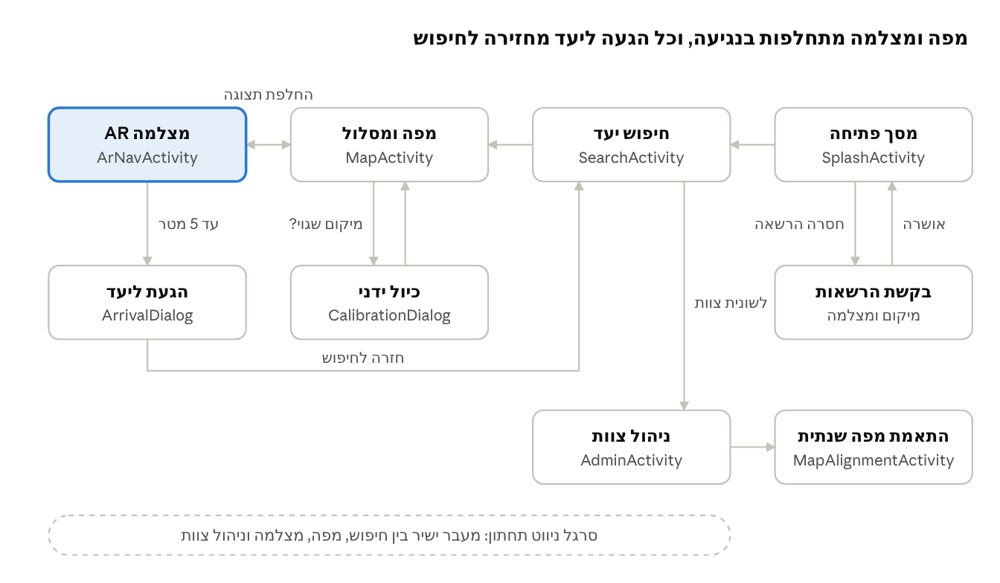

# תיק פרויקט — ניווט אלוני יצחק

## שער

| שדה | ערך |
| --- | --- |
| לוגו בית הספר | \[להוסיף בייצוא ל-Word\] |
| שם בית הספר | כפר הנוער אלוני יצחק |
| שם העבודה | ניווט אלוני יצחק — אפליקציית ניווט AR בקמפוס |
| שם התלמיד | \[שם התלמיד\] |
| ת.ז. התלמיד | \[מספר ת.ז.\] |
| שם המנחה | \[שם המנחה\] |
| שם החלופה | תכנות טלפונים חכמים, הנדסת תוכנה 883589 |
| תאריך ההגשה | \[תאריך\] |

> [!NOTE]
> **הערה לתלמידים:** בייצוא ל-Word מוסיפים לוגו, כותרת עליונה עם שם התלמיד ושם הפרויקט, כותרת תחתונה עם מספר עמוד, וגופן David או Arial בגודל עד 12, לפי ההנחיות.

## תוכן עניינים

- טבלת תכולות הפרויקט
- 1. מבוא
  - 1.1 הרקע לפרויקט
  - 1.2 תהליך המחקר
  - 1.3 אתגרים מרכזיים
  - 1.4 חידושים, התאמות ועדכונים
  - 1.5 תיאור תחום הידע
- 2. מבנה / ארכיטקטורה
  - 2.1 מסך הפתיחה
  - 2.2 תכנון ותיעוד מסכי הפרויקט
  - 2.3 תרשים מסכים
  - 2.4 תיאור מחלקות הפרויקט (UML)
- 3. מימוש הפרויקט
  - 3.1 בסיס נתונים
  - 3.2 מודל זיהוי המבנים
- 4. מדריך למשתמש
- 5. רפלקציה / סיכום אישי
- 6. ביבליוגרפיה
- 7. נספחים

> [!NOTE]
> **הערה לתלמידים:** בייצוא מחליפים את הרשימה בתוכן עניינים אוטומטי לפי כותרת 1–3. לפרויקט יש מסמכים נלווים שאינם חלק מההגשה ומסבירים את ההחלטות: [מסמך דרישות (SRS)](מסמך-דרישות-SRS), [מסמך תיכון (SDD)](מסמך-תיכון-SDD), [תוכנית ניהול פרויקט](תוכנית-ניהול-פרויקט) ו[מדריך עיצוב מסכים](מדריך-עיצוב-מסכים).

## טבלת תכולות הפרויקט

התכולות שמומשו בפרויקט, לפי סעיפי המחוון:

| סעיף | דרישה במחוון | מימוש בפרויקט |
| --- | --- | --- |
| 1 | אפליקציה לטלפון חכם בסביבת אנדרואיד | Java + XML, Android 8.0 ומעלה |
| 2 | עבודה ללא קריסות בזמן הבחינה | נבדק בבדיקות שטח לפני ההגשה |
| 3 | לוגיקה מורכבת | חישוב מסלול קצר בגרף שבילי הקמפוס (Dijkstra), הצמדת מיקום לשביל, חישוב זווית החץ |
| 4 | ממשק גרפי אינטראקטיבי עם מספר מסכים | 7 מסכים ו-2 חלונות דיאלוג, בעברית מימין לשמאל |
| 5 | אירועים והרשאות בזמן ריצה | מאזיני מיקום וחיישנים, נגיעות במפה, הרשאות מיקום ומצלמה |
| 6.3 | מחלקת Service משמעותית | LocationService — שירות מיקום שפועל בזמן ניווט |
| 6.4 | מסד נתונים עם יחסים ו-DAO עם שאילתות מתקדמות | טבלאות rooms, nodes ו-edges ב-Room, ושאילתות JOIN ביניהן |
| 6.9 | RecyclerView | רשימת תוצאות החיפוש והמועדפים |
| 7 | בסיס נתונים עם כתיבה וקריאה | Firestore (מרוחק) ו-Room (מקומי) |
| 8 | לפחות 2 נושאים מסעיף 9 ו-2 מסעיף 10 | 4 נושאים מסעיף 9 ו-4 מסעיף 10, בשורות הבאות |
| 9.4 | מפות ושימוש בנתוני מיקום | מפת OpenStreetMap (osmdroid) עם תרשים בית הספר כשכבה, מסלול ומיקום חי |
| 9.6 | מאזיני מיקום ותנועה | שירות המיקום וחיישן הכיוון |
| 9.11 | "בינה אנושית": מנוע או מודל אלגוריתמי מורכב | מנוע ניווט מבוסס גרף |
| 9.12 | מנוע למידת מכונה: איסוף נתונים, אימון והטמעה | מודל זיהוי מבני הקמפוס מהמצלמה |
| 10.3 | מצלמה | תצוגת מצלמה חיה וזיהוי מבנים |
| 10.6 | GPS | מיקום המשתמש |
| 10.10 | חיישנים | Rotation Vector וזיהוי צעדים |
| 7 → 10 | בסיס נתונים מרוחק עם עדכון בזמן אמת (נחשב כשני נושאים מסעיף 10) | Firestore |

> [!NOTE]
> **הערה לתלמידים:** סעיפים 1–5 הם תנאי סף. מעבר להם, המינימום ל-5 יח"ל הוא שני נושאים מסעיף 6, בסיס נתונים אחד (סעיף 7), ושני נושאים מסעיף 9 ושניים מסעיף 10 (סעיף 8). הפרויקט הזה מממש יותר מהמינימום כדי להדגים טווח רחב של נושאים; תלמיד לא חייב לממש את כולם. ההיגיון מאחורי כל בחירה נמצא ב[מסמך התיכון](מסמך-תיכון-SDD), וכל הדרישות המפורטות ב[מסמך הדרישות](מסמך-דרישות-SRS). מספור הסעיפים לקוח מ[מחוון 5 יח"ל](https://meyda.education.gov.il/files/CSIT/smartphonesProject-5.pdf) — יש לבדוק אותו מול הגרסה העדכנית.

> [!NOTE]
> **הערה לתלמידים:** סעיף 9.4 מאפשר Google Maps "או שירות דומה". נבחר OpenStreetMap כי Google Maps דורש מפתח API וחשבון חיוב, ובכל מקרה אף שירות לא מכיר את שבילי הקמפוס — המידע הזה בא מתרשים בית הספר. ההשוואה ב[מסמך התיכון](מסמך-תיכון-SDD), סעיף 2.4.

## 1. מבוא

### 1.1 הרקע לפרויקט

**שם הפרויקט:** ניווט אלוני יצחק.

**תיאור קצר:** אפליקציית Android שמובילה את המשתמש מהמקום שבו הוא עומד אל כל חדר בקמפוס. הניווט מוצג בשתי דרכים: חצים על גבי תמונת המצלמה, בדומה ל-Live View של Google Maps, ומסלול על מפת הקמפוס. המשתמש מחפש יעד לפי מספר חדר, שם או בעל תפקיד.

**קהל היעד:**

- תלמידים חדשים, בעיקר בשבועות הראשונים של השנה
- מורים חדשים ומחליפים
- אורחים: הורים בערבי הורים, בוחנים חיצוניים ומבקרים
- צוות בית הספר, שמעדכן את נתוני החדרים בכל שנה

**הסיבות לבחירת הנושא:** בקמפוס כ-74 חדרים הפזורים בין מבנים נפרדים, מתחם הוילות ושבילים פתוחים. בכל תחילת שנה השאלה "איפה חדר 42?" חוזרת שוב ושוב, ותרשים המבנה קיים רק כקובץ PDF שקשה לקרוא בטלפון תוך כדי הליכה. הנושא משלב בעיה אמיתית מהסביבה הקרובה עם חיישנים, מצלמה ואלגוריתמים על גרפים.

### 1.2 תהליך המחקר

המחקר המקדים כלל עבודת שטח: הליכה בין המבנים עם טלפון ומדידת דיוק ה-GPS ליד כניסות לכיתות.

**מחקר על תחום הידע:**

- מיקום לווייני (GPS) בטלפון נותן בשטח פתוח שגיאה של כמה מטרים, וליד מבנים השגיאה גדלה.
- חיישן ה-Rotation Vector משלב מצפן, ג'ירוסקופ ואקסלרומטר, ונותן כיוון יציב יותר ממצפן לבדו.
- מציאות רבודה (AR) מאפשרת לעגן אובייקט וירטואלי, כמו חץ, למקום קבוע במרחב בזמן שהטלפון זז.
- מסלול קצר בין שתי נקודות ברשת שבילים מחושב כמסלול קצר בגרף ממושקל.

**בדיקת אפליקציות קיימות:**

| אפליקציה | מה היא נותנת | מה חסר לקמפוס שלנו |
| --- | --- | --- |
| Google Maps (כולל Live View) | ניווט ברחובות וחצים על המצלמה | אין בה את שבילי הקמפוס ואת מספרי החדרים |
| תרשים המבנה (PDF) | מיקום כל חדר | סטטי, לא מראה איפה אני ולא איך מגיעים |
| מערכות ניווט פנים-מבני מסחריות | ניווט מדויק בתוך מבנים | דורשות התקנת משדרים בכל מבנה ועלות שאינה מתאימה לבית ספר |

**סקירת המצב הקיים בשוק:** פתרונות ניווט לקמפוסים קיימים בעיקר באוניברסיטאות ובקניונים, ונשענים על חומרה ייעודית. לא נמצא פתרון זמין לבית ספר שמשתמש רק בטלפון של המשתמש.

**טכנולוגיות שאינן חלק מתוכנית הלימודים:**

| טכנולוגיה | שימוש בפרויקט |
| --- | --- |
| Fused Location Provider | קבלת מיקום משולב מ-GPS, Wi-Fi ורשת סלולרית |
| Rotation Vector Sensor | כיוון הטלפון לסיבוב החץ |
| CameraX | הצגת תמונת המצלמה החיה |
| ARCore | עיגון החץ במרחב |
| Room | בסיס נתונים מקומי מעל SQLite, לצד Firebase Firestore בענן |
| TensorFlow Lite ו-Teachable Machine | אימון מודל זיהוי מבנים והרצתו בטלפון |
| אלגוריתם Dijkstra | חישוב מסלול קצר בגרף השבילים |
| osmdroid (OpenStreetMap) | מפה בדו-ממד, עם תרשים בית הספר, המסלול והמיקום כשכבות |

### 1.3 אתגרים מרכזיים

**הצורך שהפרויקט עונה עליו:** להביא אדם שאינו מכיר את הקמפוס אל דלת החדר הנכון, בלי לשאול אנשים בדרך ובלי לפענח תרשים.

**בעיות מרכזיות בפיתוח:**

1. **דיוק המיקום:** שגיאה של 5–10 מטר מספיקה כדי לשלוח את המשתמש לדלת הלא נכונה.
2. **יציבות החץ:** הפרעה מגנטית ליד מבנים משבשת את המצפן, והחץ "רוקד".
3. **מיפוי הקמפוס:** אין מפה דיגיטלית של השבילים והכניסות, וצריך ליצור אותה בעבודת שטח.
4. **תמיכת מכשירים:** ARCore אינו נתמך בכל מכשיר Android.

**פתרונות שנבחנו:**

| פתרון | יתרון | חיסרון | הוחלט |
| --- | --- | --- | --- |
| משדרי Bluetooth בכל מבנה | דיוק גבוה | עלות, התקנה ותחזוקה | לא |
| קודי QR ליד כל דלת לקביעת מיקום | זול ומדויק בנקודה | המשתמש חייב לסרוק שוב ושוב | כגיבוי בלבד |
| GPS עם הצמדה לשביל, החלקה וספירת צעדים | עובד בלי חומרה, במבנים פתוחים | דיוק מוגבל ליד מבנים | כן |
| זיהוי המבנה מהמצלמה במודל שאומן | מתקן את המיקום ליד מבנים, בלי חומרה | דורש איסוף ותיוג של מאות תמונות | כן, בשילוב עם GPS |

לבעיית החץ נבחר שילוב של עיגון ב-ARCore עם מצב גיבוי לפי מצפן בלבד במכשירים ללא תמיכה.

### 1.4 חידושים, התאמות ועדכונים

- **זיהוי מבנים במצלמה:** מודל שאומן על צילומים מהקמפוס מזהה מול איזה מבנה המשתמש עומד ומתקן את מיקום ה-GPS.
- **מפה שמתעדכנת בלי גרסה חדשה:** נתוני החדרים נשמרים ב-Firestore ומועתקים לבסיס הנתונים המקומי, ובכל שנה איש צוות מתאים את תרשים בית הספר החדש למפה ומשייך את החדרים, בלי לשנות קוד.
- **התאמה לקמפוס פתוח:** במקום תשתית ניווט פנים-מבני, הפרויקט מנצל את העובדה שהשבילים בין המבנים פתוחים לשמיים.
- **עיצוב:** ממשק בעברית מימין לשמאל, וכל הנחיה במצלמה מופיעה גם כטקסט למי שלא יכול או לא רוצה להרים את הטלפון.

### 1.5 תיאור תחום הידע

הקמפוס מיוצג כגרף: כל צומת שבילים וכל כניסה לחדר הם נקודות, וכל קטע שביל הוא קשת עם אורך במטרים.

**אובייקטים נחוצים:**

| אובייקט | מה הוא מייצג |
| --- | --- |
| חדר | כיתה, משרד או שירות בקמפוס, עם מספר, שם, בעל תפקיד ונקודת כניסה |
| נקודה | מקום פיזי בקמפוס: צומת שבילים או כניסה לחדר |
| קשת | קטע שביל ישר בין שתי נקודות |
| מסלול | רצף נקודות מהמיקום הנוכחי עד הכניסה ליעד |
| מיקום משתמש | קו רוחב, קו אורך, כיוון ודיוק ברגע נתון |
| מועדף / חיפוש אחרון | חדר ששמר המשתמש או שחיפש לאחרונה |
| זיהוי מבנה | תוצאת המודל על תמונת מצלמה: איזה מבנה נראה ובאיזו ודאות |
| תרשים בית הספר | תרשים המבנה של שנת הלימודים, מותאם למפה בעזרת נקודות עיגון |

**סוגי נתונים:**

| אובייקט | שדות וסוגים |
| --- | --- |
| חדר | number: String ("42", "יא3"), name: String, owner: String, entranceNodeId: int |
| נקודה | id: int, lat: double, lng: double |
| קשת | fromId: int, toId: int, length: double (מטרים) |
| מסלול | nodes: List\<Node>, totalDistance: double |
| מיקום משתמש | lat: double, lng: double, heading: float (מעלות), accuracy: float (מטרים) |
| מועדף / חיפוש אחרון | roomNumber: String, timestamp: long |
| זיהוי מבנה | label: String ("מבנה ט'"), confidence: float (0–1), nodeId: int (הנקודה בשביל מול המבנה) |
| תרשים בית הספר | year: String, imageUrl: String, controlPoints: List (זוגות של נקודה בתרשים ונקודה במפה) |

**ייצוג מידע:**

- **גרף השבילים** מיוצג כרשימת שכנויות: לכל נקודה רשימת הקשתות שיוצאות ממנה. נבחר ייצוג זה כי הגרף דליל (לכל צומת 2–4 שבילים), ו-Dijkstra עובר בכל צעד רק על השכנים של הנקודה הנוכחית.
- **החדרים** נשמרים בטבלה בבסיס הנתונים ונטענים לטבלת גיבוב (HashMap) לפי מספר חדר, לחיפוש מהיר.
- **המסלול** הוא רשימה מסודרת של נקודות, כי הניווט עובר עליה לפי הסדר ומחפש תמיד את הנקודה הבאה.
- **בבסיס הנתונים** שתי שכבות: ב-Firestore האוספים rooms, nodes ו-edges, וב-Room עותק מקומי שלהם ועוד הטבלאות favorites ו-recent. קשתות מפנות לנקודות לפי מזהה, וחדר מפנה לנקודת הכניסה שלו.

**פעולות על המידע:**

| פעולה | על מה | מתי |
| --- | --- | --- |
| הוספה | חדרים, נקודות וקשתות | בטעינה ראשונה מהרשת, ובמסך העריכה לצוות |
| עדכון | שם ובעל תפקיד של חדר; מיקום המשתמש | בתחילת שנה; כמה פעמים בשנייה בזמן ניווט |
| קריאה | חדר לפי מספר או שם; שכני נקודה; מועדפים | בחיפוש; בחישוב מסלול; במסך החיפוש |
| מחיקה | מועדף; חדר שבוטל | לבקשת המשתמש; במסך העריכה לצוות |

## 2. מבנה / ארכיטקטורה

הפרק מחולק לשניים: תכנון ותיעוד המסכים, ובחירת המחלקות והקשרים ביניהן. בפרק זה אין התייחסות לקוד המחלקות.

### 2.1 מסך הפתיחה

מסך הפתיחה מציג את שם האפליקציה ואת סמל בית הספר, מבקש הרשאות מיקום ומצלמה עם הסבר קצר לכל אחת, ומסנכרן את נתוני הקמפוס. הוא אינו נקודת ניווט: בסיום הוא עובר אוטומטית למסך החיפוש, ואין חזרה אליו.

### 2.2 תכנון ותיעוד מסכי הפרויקט

&#91;תמונות המסכים מהאפליקציה יתווספו בשלב הפיתוח, מתחת לכל שורה בטבלה.\]

> [!NOTE]
> **הערה לתלמידים:** לפני כתיבת ה-XML כל מסך עוצב ב-Google Stitch וב-Figma. הפרומפטים, שפת העיצוב והתהליך נמצאים ב[מדריך עיצוב המסכים](מדריך-עיצוב-מסכים). לתיק נכנסים צילומי מסך מהאפליקציה האמיתית, לא העיצובים. עיצובי Figma נמצאים בנספח א', וסקירת העיצוב ששינתה את הטבלה שלמטה נמצאת במדריך, סעיף 7.1.

| מסך | תפקיד | מידע ופעולות | רכיבי תצוגה ותפקידם |
| --- | --- | --- | --- |
| מסך פתיחה | כניסה לאפליקציה | הרשאות וסנכרון נתונים | פס התקדמות — מצב הסנכרון; מצב הרשאות — הסבר לכל הרשאה וכפתור "אישור והמשך"; כפתור "נסה שוב" — מופיע כשהסנכרון נכשל |
| חיפוש יעד | בחירת חדר | חיפוש לפי מספר, שם או בעל תפקיד; מועדפים וחיפושים אחרונים | תיבת חיפוש — קלט טקסט; רשימת תוצאות — בחירה בנגיעה; כוכב — הוספה למועדפים; סרגל ניווט תחתון — מעבר בין חיפוש, מפה, מצלמה וניהול צוות |
| מפה ומסלול | הצגת המסלול על מפת הקמפוס | מיקום המשתמש, המסלול ומרחק ליעד | מפת OpenStreetMap ועליה תרשים בית הספר — כפתור "מיקום שגוי?" — פתיחת הכיול; כפתור מצלמה — מעבר למסך המצלמה; תווית מרחק — מטרים שנותרו |
| מצלמה AR | ניווט בזמן הליכה | חץ כיוון על תמונת המצלמה, מרחק ונקודה הבאה | תצוגת מצלמה; חץ תלת-ממדי — כיוון ההליכה; פס טקסט תחתון — אותה הנחיה במילים; כפתור מפה — חזרה למפה |
| כיול ידני | תיקון מיקום שגוי | סימון המיקום האמיתי על המפה | מפה מוקטנת — נגיעה מסמנת נקודה; כפתור "אשר" — חישוב מסלול מחדש; כפתור "ביטול" |
| הגעת ליעד | הודעת סיום | שם החדר ובעל התפקיד | כותרת "הגעת"; כפתור "יעד חדש" — חזרה לחיפוש |
| עריכה לצוות | עדכון פרטי חדרים | התחברות צוות, בחירת חדר ועריכת שם ובעל תפקיד | שדות דוא"ל וסיסמה; רשימת חדרים; שדות עריכה; כפתור "שמור" — כתיבה לענן; כפתור "עדכון מפה שנתית" |
| התאמת מפה שנתית | התאמת תרשים השנה למפה ושיוך חדרים | טעינת התרשים, סימון נקודות עיגון, תצוגה מקדימה ושיוך כל חדר לכניסה שלו | מפה עם התרשים בשקיפות; מחוון שקיפות; כפתור "הוסף נקודת עיגון"; כפתור "אני עומד כאן" — נקודה לפי GPS; כפתור "שמור התאמה"; טופס שיוך חדר |

### 2.3 תרשים מסכים

זרימת מסכים · 9 מסכים

הזרימה הראשית רצה מימין לשמאל: פתיחה, חיפוש, מפה ומצלמה. מסך המצלמה הוא לב האפליקציה; הגעה ליעד אפשרית גם ממסך המפה, ומשם חוזרים תמיד לחיפוש. בנוסף, סרגל ניווט תחתון מחבר את ארבעת המסכים הראשיים — חיפוש, מפה, מצלמה וניהול צוות — ומאפשר לעבור ביניהם בנגיעה אחת.

### 2.4 תיאור מחלקות הפרויקט (UML)

תרשים מחלקות · 25 מחלקות בארבע חבילות

המחלקות מחולקות לארבע חבילות: מסכים (ui), לוגיקה וחיישנים (logic), נתונים (data) וישויות (model). כל חץ מסמן תלות: המחלקה שבמקור החץ משתמשת במחלקה שבקצה. התלות רצה רק כלפי מטה, ולכן מסך אף פעם לא ניגש ישירות לחיישן או לבסיס הנתונים.

> [!NOTE]
> **הערה לתלמידים:** בתיק נדרשים רק תרשים מסכים ותרשים מחלקות. תרשימי הפריסה, הרצף, המצבים והפעילות ותרשים הנתונים נמצאים ב[מסמך התיכון](מסמך-תיכון-SDD), כדוגמה לעבודה הנדסית מלאה.

## 3. מימוש הפרויקט

&#91;יושלם בשלב הפיתוח: לכל מחלקה — שם, תפקיד, תכונות ופעולות עיקריות עם קוד, ותרשימי זרימה לזימון פעולות סדרתי.\]

### 3.1 בסיס נתונים

נתוני הקמפוס — חדרים, נקודות וקשתות — נשמרים ב-Firestore, כך שעדכון של איש צוות מגיע לכל המכשירים. בכל טלפון נשמר עותק שלהם ב-Room, יחד עם המועדפים והחיפושים האחרונים, כדי שהניווט יעבוד גם בלי קליטה.

&#91;יושלם בשלב הפיתוח: סקירת הטבלאות, דוגמה לכל טבלה והפעולות על בסיס הנתונים.\]

> [!NOTE]
> **הערה לתלמידים:** לסעיף 7 במחוון מספיק בסיס נתונים אחד — Room לבד או Firestore לבד. בפרויקט הזה נבחרו שניהם כדי להדגים חלוקת תפקידים בין ענן לטלפון. ההשוואה ביניהם, דוגמאות קוד ותרשים הנתונים נמצאים ב[מסמך התיכון](מסמך-תיכון-SDD), סעיפים 2.1 ו-8.

### 3.2 מודל זיהוי המבנים

מודל סיווג תמונות שאומן על צילומי מבני הקמפוס מזהה מול איזה מבנה המשתמש עומד, והמיקום מתוקן לפי הזיהוי.

&#91;יושלם בשלב הפיתוח: איסוף והכנת הנתונים, בניית המודל ואימונו, תוצאות ההערכה והשילוב באפליקציה.\]

> [!NOTE]
> **הערה לתלמידים:** סעיף 9.12 במחוון דורש איסוף נתונים, אימון והטמעה, ולכן אומן מודל עצמאי ולא נעשה שימוש בכלי GenAI מוכן (סעיף 6.12). פירוט השלבים נמצא ב[מסמך התיכון](מסמך-תיכון-SDD), סעיף 10.

## 4. מדריך למשתמש

יושלם בשלב היישום: גרסאות ומכשירים שעליהם נבדק הפרויקט, הוראות התקנה, אופן הפעולה, הודעות למשתמש ומגבלות.

## 5. רפלקציה / סיכום אישי

יושלם בסוף השנה: תהליך העבודה, למידה עצמית, כלים להמשך, תובנות, ומה הייתי עושה אחרת. לפחות חצי עמוד עד עמוד.

## 6. ביבליוגרפיה

יושלם לאורך השנה, לפי כללי APA, כולל קישורים ציבוריים לשיחות עם כלי בינה מלאכותית שמהן יובא קוד.

## 7. נספחים

קוד המחלקות כתדפיס מסודר עם הערות Javadoc, והסברים על הטכנולוגיות שבשימוש.

### נספח א' — עיצובי המסכים

עיצובי המסכים מ-Figma, שלפיהם נבנה הממשק. צילומי המסך מהאפליקציה עצמה מופיעים בפרק 2.2.

עיצובי המסכים, חלק 1: פתיחה, הרשאות, חיפוש, מפה ומצלמה

עיצובי המסכים, חלק 2: הגעה ליעד, כיול, כניסת צוות, ניהול חדרים והתאמת מפה

